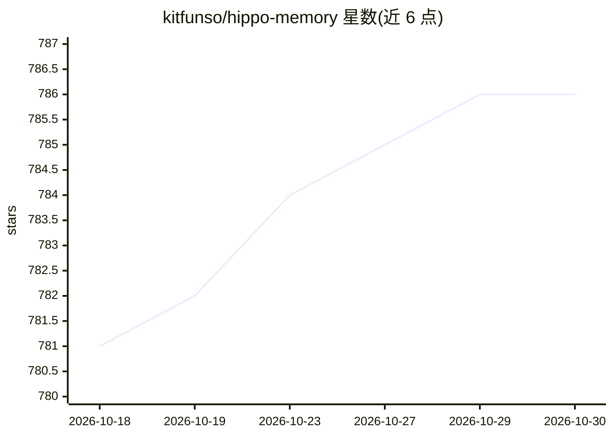

# kitfunso/hippo-memory

⭐ 786 · TypeScript · MIT · 推送 2026-10-29 · [GitHub](https://github.com/kitfunso/hippo-memory) · [官网](https://hippo-memory.com) · 个人维护

**给编码 agent 的本地长期记忆层：跨工具共享一个记忆库**

面向编码 agent（Claude Code、Codex、Cursor、OpenCode 等）的长期记忆层：以本机 SQLite 存储为核心、附 markdown 镜像，默认 BM25 检索且不联网，可选本地 Transformers.js 嵌入或 API embedder。hippo init 自动为检测到的 agent 安装 hooks 与 AGENTS.md 指令块，并设置每日 6:15 定时任务；hippo sleep 从 git 提交与 agent 记忆中学习、做衰减/合并/去重。记忆有 kind/scope/owner 溯源，支持标记降权与 supersede 替换。零运行时依赖，需 Node.js 22.16+。README 列有基准测试结果，其中一项声明已撤回。

## 筛选速览

| 维度 | 判定 | 备注 |
|---|---|---|
| AI 角色 | `ai-ecosystem` | LLM/agent 周边工具 |
| 许可风险 | `permissive` | MIT |
| 部署形态 | `library` | 以包/库形式分发 |
| 模型依赖 | — | README 未给出锁定关系 |
| 硬件要求 | — | 无带数字的原话,不猜 |
| 安装摩擦 | `low` | 无编译、无系统依赖或容器化 |
| 成熟度 | — | 结构信号不足 |

## 能力要点

- SQLite + markdown 镜像本地存储，默认 BM25 检索、无网络调用
- hippo init 自动接入 Claude Code/Codex/Cursor/OpenCode 等并支持任意 MCP 客户端
- 记忆强度随使用增强、标记错误降权、supersede 替换旧事实
- 每条记忆携带 kind/scope/owner/artifact_ref 溯源，支持 GDPR 删除与多租户隔离

## 适用场景

- 让不同编码工具共享同一份项目记忆，换工具不丢上下文
- 从 git 历史与 Slack/GitHub 记录中沉淀经验教训
- 把专有数据保留在本机的同时给 agent 提供长期记忆

## 场景标签

`Agent 记忆` · 领域:Agent 开发

## 证据(README 行号)

> L15: Hippo keeps your coding agents' memories in a SQLite store on your machine, with markdown mirrors you can read and 
> L30: Works with:    Claude Code, Codex, Cursor, OpenClaw, OpenCode, Pi, any MCP client
> L33: Dependencies:  Zero runtime deps. Node.js 22.16+. Optional embeddings: bring-your-own local Transformers.js (`npm i

## 星数曲线

2026-10-18 781 → 2026-10-30 786（+5）

---
*卡片 v1 · prompt 1.4 · 生成 2026-10-22 · 置信度 high · 依据 README sha `db8c65cbefc9` · [字段定义](../../DATASET.md)*
