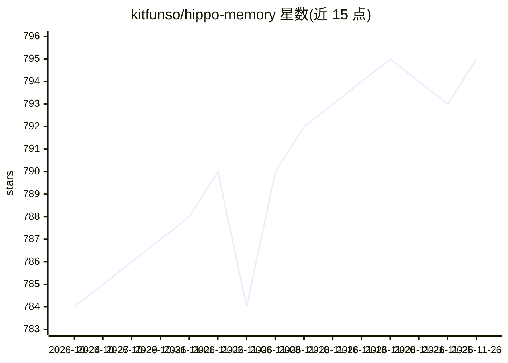

# kitfunso/hippo-memory

⭐ 795 · TypeScript · MIT · 推送 2026-11-25 · [GitHub](https://github.com/kitfunso/hippo-memory) · [官网](https://hippo-memory.com) · 个人维护

**给编码 agent 提供跨工具共享的本地记忆库**

面向使用多个编码 agent 的开发者：你教会一个 agent 的规则与教训被写入仓库内的 .hippo/ 存储（SQLite + 可提交的 markdown 镜像），其余 agent 读取同一存储，避免换工具重新积累。默认路径零 LLM 调用完成存储，recall 用关键词检索无需网络；hippo sleep 在配置 API key 时可选调用 Anthropic 或 OpenAI 兼容端点。零运行时依赖，Node.js 22.16+；hippo init 会装本地嵌入器（约 480 MB，可跳过）。npm 全局安装。

## 筛选速览

| 维度 | 判定 | 备注 |
|---|---|---|
| AI 角色 | `ai-ecosystem` | LLM/agent 周边工具 |
| 许可风险 | `permissive` | MIT |
| 部署形态 | `library` | 以包/库形式分发 |
| 模型依赖 | — | README 未给出锁定关系 |
| 硬件要求 | — | 无带数字的原话,不猜 |
| 安装摩擦 | `low` | 无编译、无系统依赖或容器化 |
| 成熟度 | — | 结构信号不足 |

## 能力要点

- 多 agent 共享同一记忆存储：Claude Code、Codex、Cursor、Gemini CLI 及任何 MCP 客户端
- 默认路径存储零模型调用，recall 为无模型无网络的关键词检索
- SQLite + markdown 镜像，可读取、diff、提交到 git
- 负面结果削弱记忆（outcome --bad）、supersede 替换旧事实、未用记忆随时间衰减

## 适用场景

- 在 Claude Code 与 Cursor 之间切换时不重复教规则
- 团队把 agent 记忆作为 markdown 提交并走代码评审
- 离线/内网环境下为编码 agent 配置共享记忆

## 场景标签

`Agent 记忆` · 领域:Agent 开发

## 证据(README 行号)

> L16: Works with:    Claude Code, Codex, Cursor, Pi, OpenClaw, OpenCode, any MCP client
> L18: Storage:       SQLite with markdown mirrors you can read and commit

## 星数曲线

2026-10-24 784 → 2026-11-26 795（+11）

---
*卡片 v1 · prompt 1.4 · 生成 2026-11-25 · 置信度 high · 依据 README sha `590e22c431c4` · [字段定义](../../DATASET.md)*
