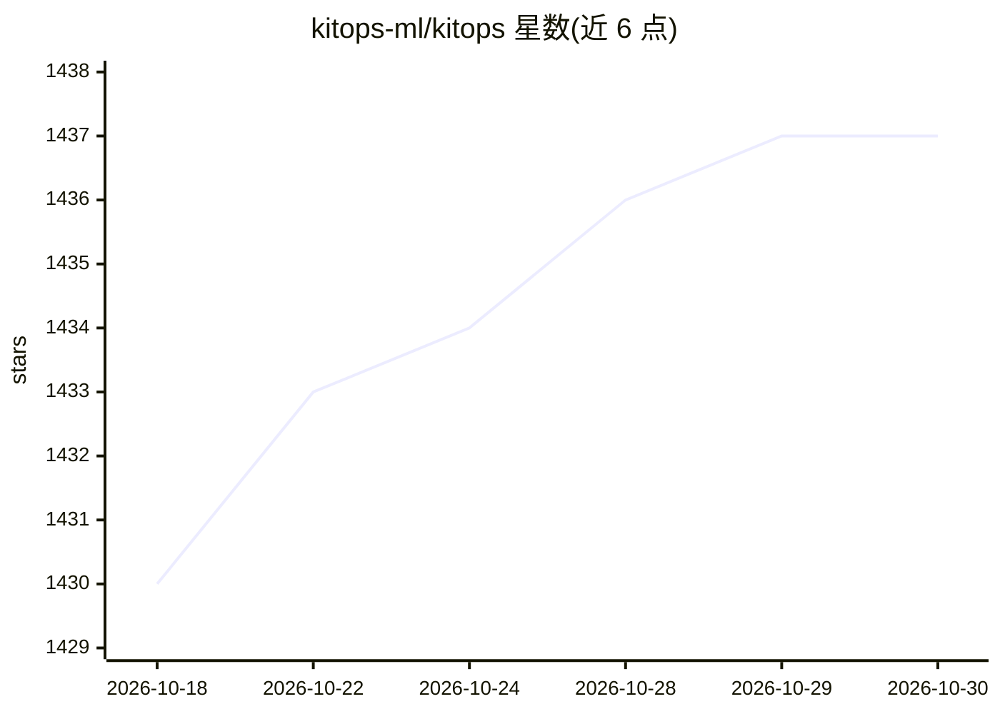

# kitops-ml/kitops

⭐ 1,437 · Go · Apache-2.0 · 推送 2026-10-26 · [GitHub](https://github.com/kitops-ml/kitops) · [官网](https://KitOps.org) · 组织维护

**把模型/数据集/代码/配置打包为 OCI 制品的 AI/ML 版本管理工具**

CNCF 治理的开源 DevOps 工具，将 AI/ML 项目的模型权重、数据集、代码与配置打包为基于 OCI 的 ModelKit（也支持 CNCF ModelPack 格式），存入既有容器注册表进行版本化管理与共享。组件以 SHA-256 摘要保证防篡改，支持 Cosign 签名、AI SBOM、按层选择性拉取。提供 Kit CLI（pack/push/pull/unpack 等）与 PyKitOps Python SDK，集成 MLFlow、GitHub Actions、KServe、Kubeflow 等。面向需要自托管模型与合规审计的企业、政府与云运营商，配套商业产品 Jozu Hub 提供集中策略管理与安全扫描。

## 筛选速览

| 维度 | 判定 | 备注 |
|---|---|---|
| AI 角色 | `ai-ecosystem` | LLM/agent 周边工具 |
| 许可风险 | `permissive` | Apache-2.0 |
| 部署形态 | `None` |  |
| 模型依赖 | — | README 未给出锁定关系 |
| 硬件要求 | — | 无带数字的原话,不猜 |
| 安装摩擦 | `low` | 无编译、无系统依赖或容器化 |
| 成熟度 | — | 结构信号不足 |

## 能力要点

- 模型/数据集/代码/配置打包为 OCI ModelKit 并存入既有容器注册表
- SHA-256 防篡改、Cosign 签名、AI SBOM 与审计级版本历史
- 按层选择性拉取（仅模型或仅数据集）
- 提供 Kit CLI 与 PyKitOps Python SDK，集成 MLFlow/KServe/Kubeflow 等

## 适用场景

- 把训练完成的模型与数据集作为不可变制品移交生产环境
- 受监管行业对模型做签名、扫描与合规审计（EU AI Act/NIST AI RMF）
- 用一套 OCI 标准管理从实验到生产的全生命周期模型版本

## 场景标签

`MLOps` · 领域:训练与推理

## 证据(README 行号)

> L13: KitOps is a CNCF open source tool for packaging, versioning, and securely sharing AI/ML projects.
> L15: Built on the same OCI (Open Container Initiative) technology that underlies containers, KitOps packages everything 

## 星数曲线

2026-10-18 1,430 → 2026-10-30 1,437（+7）

---
*卡片 v1 · prompt 1.4 · 生成 2026-10-21 · 置信度 high · 依据 README sha `489892f68f61` · [字段定义](../../DATASET.md)*
