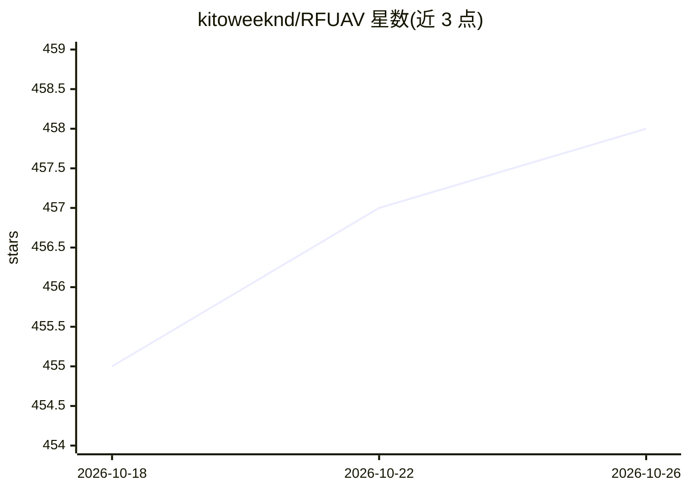

# kitoweeknd/RFUAV

⭐ 458 · Python · Apache-2.0 · 推送 2026-07-29 · [GitHub](https://github.com/kitoweeknd/RFUAV) · 组织维护 · 中文 README

**无人机射频检测识别基准数据集及配套两阶段模型代码**

论文 RFUAV 的官方仓库，提供基于射频信号的无人机检测与识别基准数据集：含 35 种无人机在高信噪比条件下的原始 IQ 录制数据及频谱图，公布子集含 37 个原始数据片段。配套代码提供 Python/MATLAB 信号处理管线（FFT/STFT 转频谱图、SNR 估计与调整、数据增强），支持 PyTorch 训练分类模型（ViT/ResNet/YOLOv5 等）及检测+分类两阶段流水线，并附 -20dB~20dB 分信噪比评测。原始数据兼容 USRP 与 GNU Radio 回放。面向从事射频无人机分析的科研人员。

## 筛选速览

| 维度 | 判定 | 备注 |
|---|---|---|
| AI 角色 | `ai-native` | 本体是模型或模型工具 |
| 许可风险 | `permissive` | Apache-2.0 |
| 部署形态 | `library` | 以包/库形式分发 |
| 模型依赖 | — | README 未给出锁定关系 |
| 硬件要求 | — | 无带数字的原话,不猜 |
| 安装摩擦 | `low` | 无编译、无系统依赖或容器化 |
| 成熟度 | — | 结构信号不足 |

## 能力要点

- 35 种无人机原始 IQ 数据及频谱图基准数据集
- 检测+分类两阶段流水线，可直接处理原始 IQ 数据
- 支持 ViT/ResNet/Swin/YOLOv5 等模型的自定义训练
- SNR 估计/调整工具（-20dB~20dB）与数据增强工具

## 适用场景

- 研究射频信号的无人机检测与型号识别
- 复现论文或训练自定义无人机分类/检测模型
- 通过 USRP/GNU Radio 回放原始无人机信号

## 场景标签

`模型评测` `科研工具` · 领域:评测与运维

## 证据(README 行号)

> L7: The official repository for our paper, *"RFUAV: A Benchmark Dataset for Unmanned Aerial Vehicle Detection and Identi
> L21: With RFUAV, you can achieve drone signal detection and identification directly on raw IQ data, as demonstrated belo

## 星数曲线

2026-10-18 455 → 2026-10-26 458（+3）

---
*卡片 v1 · prompt 1.4 · 生成 2026-10-21 · 置信度 high · 依据 README sha `622112152b29` · [字段定义](../../DATASET.md)*
