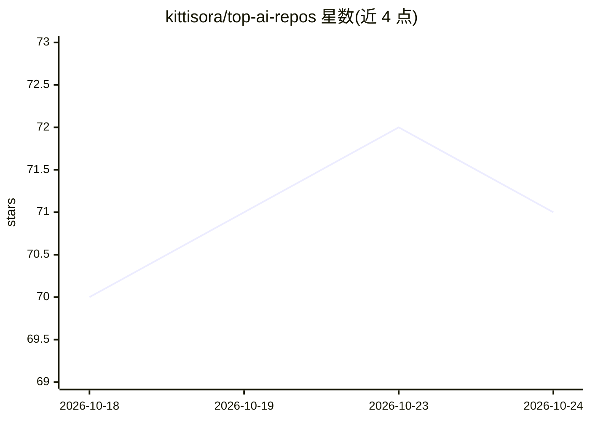

# kittisora/top-ai-repos

⭐ 71 · TypeScript · Apache-2.0 · 推送 2026-08-17 · [GitHub](https://github.com/kittisora/top-ai-repos) · [官网](https://topairepos.com) · 个人维护

**开源 AI 仓库发现与追踪站点：按趋势与质量双维度排名**

自托管的 GitHub 开源 AI 仓库目录与追踪站点（线上为 topairepos.com）：通过 317 个精选 topic 与 61 个自由词组抓取约 30,000 个仓库、33 个类别，以 npm run daily 单命令运行八阶段流水线（发现、同步、快照、贡献者、分类、评分），在 Postgres 中记录每日指标快照并计算无界的趋势分与 0-100 的质量分（维护、发布节奏、贡献者广度、bus factor、issue 健康、文档、许可安全）。分类以规则为主，仅歧义仓库调用 LLM（可选 OpenAI key）。UI 为 Next.js，需 Node 22.6+ 与 Postgres 17，可用 Supabase/Neon 免费层。限制：快照数据缺失日无法回补；README 截断 4,000 字符。

## 筛选速览

| 维度 | 判定 | 备注 |
|---|---|---|
| AI 角色 | `ai-knowledge` | 知识聚合/清单类 |
| 许可风险 | `permissive` | Apache-2.0 |
| 部署形态 | `library` | 以包/库形式分发 |
| 模型依赖 | — | README 未给出锁定关系 |
| 硬件要求 | — | 无带数字的原话,不猜 |
| 安装摩擦 | `low` | 无编译、无系统依赖或容器化 |
| 成熟度 | — | 结构信号不足 |

## 能力要点

- 趋势分+质量分双独立信号，非单纯星标排名
- 约 30,000 仓库、33 类别、53,000 贡献者，每日快照记录增量
- 单命令 npm run daily 运行完整八阶段流水线，预算适配 GitHub 5,000 请求/小时
- 分类规则优先，仅歧义仓库调用 LLM（可选，结果缓存）

## 适用场景

- 我要发现当前活跃且维护良好的开源 AI 仓库，而不是看三年前的星标排名
- 自建一个每日更新的 AI 仓库目录站点并分享筛选视图
- 评估候选依赖仓库的质量（发布节奏、bus factor、许可安全）

## 场景标签

`精选清单` · 领域:学习与行业

## 证据(README 行号)

> L3: A discovery and tracking site for open-source AI repositories on GitHub.
> L21: Currently indexing ~30,000 repositories across 33 categories, with ~53,000

## 星数曲线

2026-10-18 70 → 2026-10-24 71（+1）

---
*卡片 v1 · prompt 1.4 · 生成 2026-10-24 · 置信度 high · 依据 README sha `a865426c5f27` · [字段定义](../../DATASET.md)*
