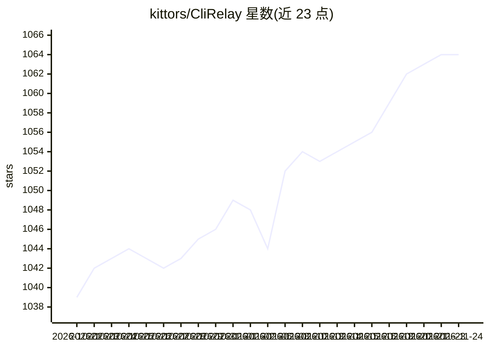

# kittors/CliRelay

⭐ 1,064 · Go · MIT · 推送 2026-11-22 · [GitHub](https://github.com/kittors/CliRelay) · 组织维护 · 中文 README

**自托管 AI 网关：把编程 CLI 订阅与 API key 汇入单一端点管理**

CliRelay 是 CLIProxyAPI 的扩展分支，将 AI CLI 订阅、OAuth 凭据、提供商 API key 与 OpenAI 兼容上游整合为一个受管理的 API 层。客户端通过 OpenAI/Anthropic/Gemini 协议访问单一端点，网关以自有 client key 认证、按调度策略选择健康上游账号、必要时翻译请求协议并记录请求日志。面向团队运行：多租户隔离、角色权限、审计日志、门户账号配额与消费限额。依赖 PostgreSQL 15+ 与 Redis 7+，提供 /manage 网页控制台（英/简中/俄三语）。

## 筛选速览

| 维度 | 判定 | 备注 |
|---|---|---|
| AI 角色 | `ai-ecosystem` | LLM/agent 周边工具 |
| 许可风险 | `permissive` | MIT |
| 部署形态 | `self-host` | docker 或自建部署 |
| 模型依赖 | local-ok | 支持本地模型 |
| 硬件要求 | — | 无带数字的原话,不猜 |
| 安装摩擦 | `low` | 无编译、无系统依赖或容器化 |
| 成熟度 | — | 结构信号不足 |

## 能力要点

- 单端点接入 Claude、Codex、Gemini CLI 及任意 OpenAI 兼容上游
- 多租户与 resource.action 粒度权限、审计日志
- 渠道分组调度：round-robin、fill-first、session-sticky，含冷却与自动故障转移
- 监控中心：健康评分、P50–P99 延迟、请求日志与配额/消费控制

## 适用场景

- 团队把已有的 Claude Code/Codex/Gemini CLI 订阅统一为内部分配的 API 端点
- 为多个用户发放 client key 并设置每日/周期/终身消费配额
- 集中查看每个请求的 token、延迟与费用并分析失败原因

## 场景标签

`模型网关` · 领域:Agent 开发

## 证据(README 行号)

> L9:  A self-hosted gateway that puts your AI coding subscriptions and API keys behind one endpoint — with a multi-tenant
> L29: CliRelay turns AI CLI subscriptions, OAuth credentials, provider API keys and OpenAI-compatible upstreams into **on
> L31: It is built to be **run by a team**. Tenants keep their accounts, keys and data apart; users get roles with fine-gr

## 星数曲线

2026-10-21 1,039 → 2026-11-24 1,064（+25）

---
*卡片 v1 · prompt 1.4 · 生成 2026-11-24 · 置信度 high · 依据 README sha `8cb571032f85` · [字段定义](../../DATASET.md)*
