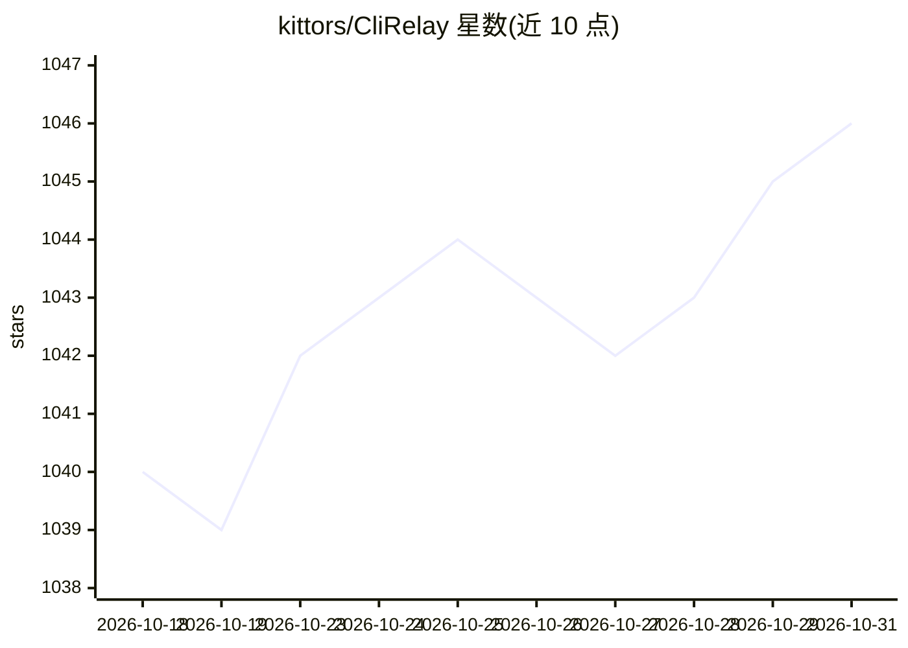

# kittors/CliRelay

⭐ 1,046 · Go · MIT · 推送 2026-10-30 · [GitHub](https://github.com/kittors/CliRelay) · 组织维护 · 中文 README

**面向编码 CLI 的自托管 AI 网关：多租户管控上游订阅与 API Key**

CLIProxyAPI 的扩展分支，用 Go 编写的自托管网关：将 Claude、Codex、Gemini CLI 等订阅、OAuth 凭据与 API Key 聚合为一个端点，支持 OpenAI/Anthropic/Gemini 三种协议。提供多租户 Web 控制面板、租户/角色/审计日志、渠道分组调度与自动故障转移、请求日志监控（延迟分位、首 token 时间、成本）以及配额与 RPM/TPM 限额。运行依赖 PostgreSQL 15+ 与 Redis 7+，推荐 Docker Compose 部署，控制面板含简体中文界面。

## 筛选速览

| 维度 | 判定 | 备注 |
|---|---|---|
| AI 角色 | `ai-ecosystem` | LLM/agent 周边工具 |
| 许可风险 | `permissive` | MIT |
| 部署形态 | `self-host` | docker 或自建部署 |
| 模型依赖 | local-ok | 支持本地模型 |
| 硬件要求 | — | 无带数字的原话,不猜 |
| 安装摩擦 | `low` | 无编译、无系统依赖或容器化 |
| 成熟度 | — | 结构信号不足 |

## 能力要点

- 单一端点聚合 Claude/Codex/Gemini 等 15 类上游，支持 OpenAI/Anthropic/Gemini 协议转换
- 多租户、角色权限（resource.action）与安全敏感操作审计日志
- 渠道分组调度、冷却与自动故障转移
- 请求级日志与监控中心（P50–P99 延迟、成本、配额）

## 适用场景

- 团队统一管理多个 AI 编码订阅与 API Key，按租户分配
- 为 Claude Code/Codex/Gemini CLI 等客户端提供带配额与审计的接入层
- 账号耗尽时自动切换渠道，保持编码工具可用

## 场景标签

`模型网关` · 领域:Agent 开发

## 证据(README 行号)

> L9:  A self-hosted gateway that puts your AI coding subscriptions and API keys behind one endpoint — with a multi-tenant
> L29: CliRelay turns AI CLI subscriptions, OAuth credentials, provider API keys and OpenAI-compatible upstreams into **on
> L39: |🔌 **One endpoint, every provider**|Claude, Codex, Gemini CLI, Antigravity, Vertex, Bedrock, xAI/Grok, Qwen, Kimi, 

## 星数曲线

2026-10-18 1,040 → 2026-10-31 1,046（+6）

---
*卡片 v1 · prompt 1.4 · 生成 2026-10-21 · 置信度 high · 依据 README sha `f939f35afe70` · [字段定义](../../DATASET.md)*
