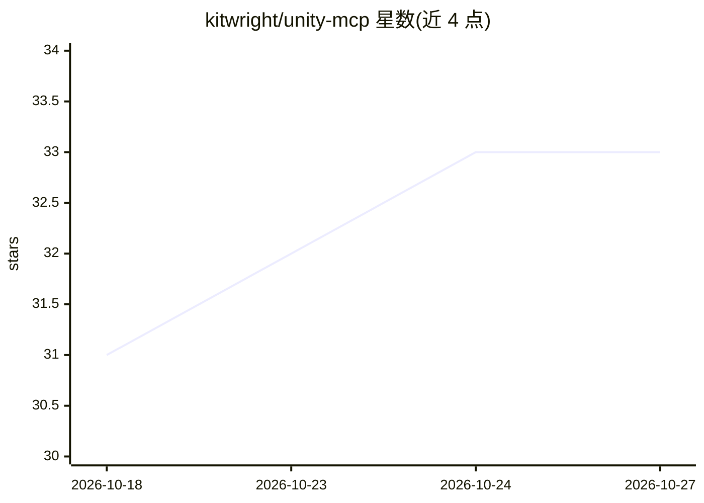

# kitwright/unity-mcp

⭐ 33 · C# · MIT · 推送 2026-10-11 · [GitHub](https://github.com/kitwright/unity-mcp) · [官网](https://kitwright.dev/) · 个人维护 · 中文 README

**让 AI 助手直接操作 Unity 编辑器的 MCP 服务器**

MIT 许可的 Unity Editor 插件，在编辑器内运行 MCP 服务器（默认 127.0.0.1:8765，Broker 模式），使 Claude Code、Cursor、LM Studio、Codex、VS Code Copilot 等 MCP 客户端能通过 274 个内置工具（core 档默认 43 个）在运行中的 Unity 项目内创建场景、生成脚本、模拟输入、截图与做性能分析。核心工具 execute_code 以 Roslyn 内存编译方式在编辑器线程运行 C# 代码片段，不写入 Assets 文件。仅 Editor 端运行，不给构建产物添加运行时组件；一键配置支持 19 种 AI 客户端。

## 筛选速览

| 维度 | 判定 | 备注 |
|---|---|---|
| AI 角色 | `ai-ecosystem` | LLM/agent 周边工具 |
| 许可风险 | `permissive` | MIT |
| 部署形态 | `None` |  |
| 模型依赖 | — | README 未给出锁定关系 |
| 硬件要求 | — | 无带数字的原话,不猜 |
| 安装摩擦 | `low` | 无编译、无系统依赖或容器化 |
| 成熟度 | — | 结构信号不足 |

## 能力要点

- 274 个内置工具覆盖场景编辑、play mode 控制、输入模拟、截图与性能分析（core 档默认 43 个）
- execute_code 经 Roslyn 内存编译在编辑器线程执行 C# 代码，不写入项目文件
- 一键为 19 种 MCP 客户端写入配置（含 Claude Code、Cursor、Codex、Kimi Code、Qwen Code 等）
- Broker 模式在脚本重编译与 Play Mode 域重载期间维持连接

## 适用场景

- 用一句话让 AI 助手在 Unity 里搭出可玩的原型（场景、脚本、UI）
- 让 AI 客户端在 play mode 中模拟键鼠输入并截图验证行为
- 通过 MCP 客户端做 Unity 编辑器自动化与性能检查

## 场景标签

`GUI 自动化` · 领域:效率与自动化

## 证据(README 行号)

> L16: KitWright MCP for Unity is an MIT-licensed Unity Editor MCP server that lets AI assistants like Claude Code, Cursor
> L18: Describe your game in one sentence — your AI assistant builds it in Unity through KitWright MCP for Unity's 274 bui
> L189: - The package defaults to the `core` MCP tool profile to reduce tool-list noise for AI clients. `core` currently e

## 星数曲线

2026-10-18 31 → 2026-10-27 33（+2）

---
*卡片 v1 · prompt 1.4 · 生成 2026-10-25 · 置信度 high · 依据 README sha `82ad1d513f72` · [字段定义](../../DATASET.md)*
