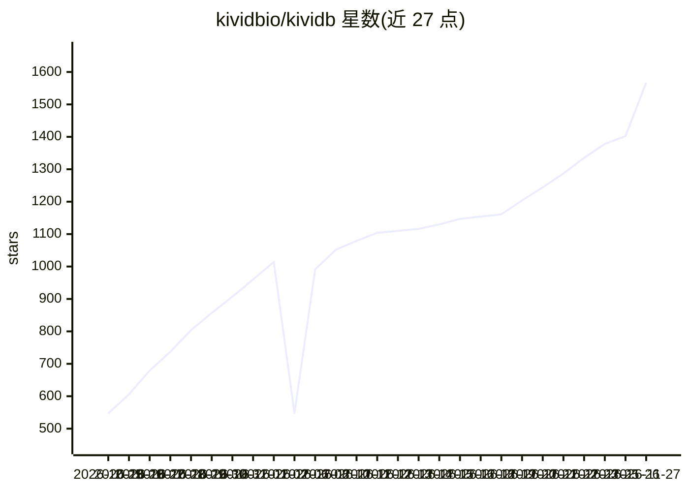

# kividbio/kividb

⭐ 1,567 · Rust · AGPL-3.0 · 推送 2026-11-26 · [GitHub](https://github.com/kividbio/kividb) · [官网](https://kividb.io) · 组织维护 · 中文 README

**Redis 兼容的 Rust 内存数据库，内置向量与全文检索**

用 Rust 编写的多线程内存键值数据库，讲 Redis 协议（RESP2/RESP3），现有 Redis 客户端与 redis-cli 无需改动即可使用。核心数据结构覆盖字符串、列表、哈希、集合、有序集合、流、位图等，内置 Redis Stack 风格的 FT.* 全文、标签、数值与向量检索（FLAT/HNSW），另含 JSON、时间序列、快照与 AOF 持久化、主从复制、集群、ACL 与 TLS、Lua 脚本。默认监听 6380 端口，可与 Redis 并存；提供 apt/dnf/brew/cargo/Docker 安装与 Kubernetes operator。

## 筛选速览

| 维度 | 判定 | 备注 |
|---|---|---|
| AI 角色 | `ai-enhanced` | 去掉 AI 部分产品仍成立 |
| 许可风险 | `viral` | AGPL-3.0 |
| 部署形态 | `self-host` | docker 或自建部署 |
| 模型依赖 | — | README 未给出锁定关系 |
| 硬件要求 | — | 无带数字的原话,不猜 |
| 安装摩擦 | `low` | 无编译、无系统依赖或容器化 |
| 成熟度 | `idea` | |

## 能力要点

- 讲 RESP2/RESP3 协议，现有 Redis 客户端无需改动
- 内置 Redis Stack 风格 FT.* 全文与向量检索（FLAT/HNSW）
- 快照加可选 AOF 持久化，支持复制与集群 failover
- 提供 apt/dnf/brew/cargo/Docker 与 Kubernetes operator

## 适用场景

- 替代 Redis 承接缓存与键值负载且需端口并存
- 在数据库内直接做向量检索支撑相似度查询
- 需要全文、JSON 与时间序列命令的内存数据场景

## 场景标签

`向量数据库` · 领域:知识与检索

## 证据(README 行号)

> L16: **KiviDB** is a fast, multi-threaded alternative to Redis® and Valkey, written in Rust. It
> L99: - **Search and vectors**: Redis Stack–style `FT.*` commands for full-text, tag, numeric and
> L131: Copyright (c) 2026 KIVIDB PRIVATE LIMITED.

## 星数曲线

2026-10-25 547 → 2026-11-27 1,567（+1,020）

---
*卡片 v1 · prompt 1.4 · 生成 2026-11-23 · 置信度 high · 依据 README sha `72441915280e` · [字段定义](../../DATASET.md)*
