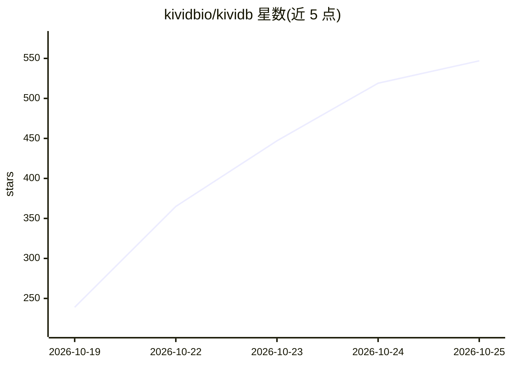

# kividbio/kividb

⭐ 547 · Rust · AGPL-3.0 · 推送 2026-10-24 · [GitHub](https://github.com/kividbio/kividb) · [官网](https://kividb.io) · 组织维护

**Rust 编写的多线程 Redis/Valkey 兼容内存数据库，内置全文与向量检索**

KiviDB 是以 Rust 实现的内存键值数据库，实现 Redis 协议（RESP2/RESP3），现有 Redis 客户端与 redis-cli 可直接连接（默认端口 6380）。每个核上运行分片化设计，支持快照与可选 AOF 持久化；内置 Redis Stack 风格的 FT.* 命令，提供全文（BM25）、标签/数值过滤与向量 ANN 检索（FLAT/HNSW），向量索引与 HNSW 图可随快照持久化。提供 Docker 镜像、.deb/.rpm 包、Linux/macOS 发布二进制及源码构建四种途径；Lua 与 TLS 为构建期可选特性。许可证为 AGPL-3.0-only。

## 筛选速览

| 维度 | 判定 | 备注 |
|---|---|---|
| AI 角色 | `ai-enhanced` | 去掉 AI 部分产品仍成立 |
| 许可风险 | `dual` | AGPL-3.0 |
| 部署形态 | `desktop` | 安装包/桌面程序 |
| 模型依赖 | — | README 未给出锁定关系 |
| 硬件要求 | — | 无带数字的原话,不猜 |
| 安装摩擦 | `low` | 无编译、无系统依赖或容器化 |
| 成熟度 | — | 结构信号不足 |

## 能力要点

- Redis 协议兼容（RESP2/RESP3），现有客户端可直接使用
- 内置 FT.* 全文（BM25）与向量检索（FLAT/HNSW）
- HNSW 图可随快照（dump.kdb）持久化，重启后检索质量不回退
- 四种构建变体（default/lua/tls/full），Linux 支持 io_uring 并可回退 Tokio

## 适用场景

- 替换 Redis/Valkey 作为缓存或键值存储并保持客户端兼容
- 在数据库内直接做向量 ANN 检索与全文混合查询
- 通过 Docker 或 deb/rpm 包部署单机内存数据库服务

## 场景标签

`向量数据库` · 领域:知识与检索

## 证据(README 行号)

> L5: **KiviDB** is a fast, multi-threaded alternative to Redis® and Valkey, written in Rust. It
> L7: libraries work unchanged, and it has full-text and vector search built in. It runs every
> L23: - **Search and vectors**: Redis Stack–style `FT.*` commands for full-text, tag, numeric and vector (FLAT / HNSW) se

## 星数曲线

2026-10-19 239 → 2026-10-25 547（+308）

---
*卡片 v1 · prompt 1.4 · 生成 2026-10-21 · 置信度 high · 依据 README sha `dc1f67d097f2` · [字段定义](../../DATASET.md)*
