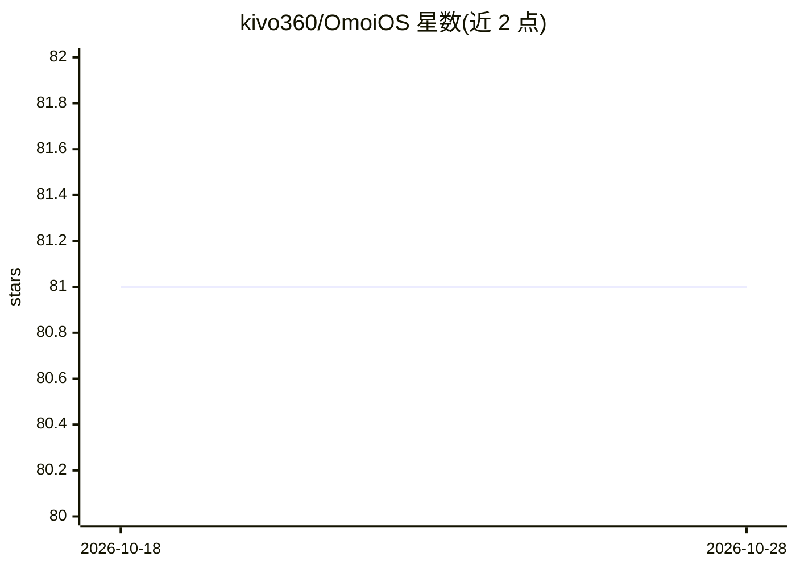

# kivo360/OmoiOS

⭐ 81 · Python · Apache-2.0 · 推送 2026-10-07 · [GitHub](https://github.com/kivo360/OmoiOS) · [官网](https://omoios.dev) · 个人维护

**自托管的多编码代理群体运行时：从功能规格到合并 PR**

面向开发者的自托管代理群体运行时：读取现有代码库生成规格（Explore→Requirements→Design→Tasks），构建任务 DAG 依赖图并行调度编码代理，每个代理在隔离的 Daytona 容器沙箱中独立分支执行，Guardian 每 60 秒监控代理轨迹并注入纠偏，最终由合并服务按序合入分支并落地 PR。模型无关，支持 Claude（Agent SDK）/Gemini/Codex。技术栈为 Next.js 15 + FastAPI + PostgreSQL 16(pgvector) + Redis，通过 just quickstart 一键部署，需 Docker/Python 3.12+/Node 22+ 等前置依赖，LLM 功能需配置 API key。

## 筛选速览

| 维度 | 判定 | 备注 |
|---|---|---|
| AI 角色 | `ai-ecosystem` | LLM/agent 周边工具 |
| 许可风险 | `permissive` | Apache-2.0 |
| 部署形态 | `self-host` | docker 或自建部署 |
| 模型依赖 | locked-api |  |
| 硬件要求 | — | 无带数字的原话,不猜 |
| 安装摩擦 | `low` | 无编译、无系统依赖或容器化 |
| 成熟度 | — | 结构信号不足 |

## 能力要点

- 基于代码库生成规格，任务以 DAG 依赖图并行执行
- 每个代理运行在独立 Daytona 容器沙箱，自动合并分支
- Guardian 监控代理轨迹并注入纠偏，Discovery 自动派生新任务
- Apache-2.0、自托管、模型无关（Claude/Gemini/Codex）

## 适用场景

- 把功能描述交给代理群体并行开发并产出可合并的 PR
- 在隔离沙箱中同时运行多个编码代理避免互相干扰
- 自托管一套带仪表盘与看板的代理编排平台

## 场景标签

`Agent 框架` `多智能体` `编码 Agent` · 领域:Agent 开发

## 证据(README 行号)

> L23: **OmoiOS fixes this.** It reads your existing codebase, generates specs from what's actually there, builds a task D
> L32: This isn't prompt chaining. It's a **structured runtime for agent swarms** — with dependency graphs, sandboxed exec
> L320: |**LLM**|Claude (Agent SDK)|AI agent backbone|

## 星数曲线

2026-10-18 81 → 2026-10-28 81（+0）

---
*卡片 v1 · prompt 1.4 · 生成 2026-10-24 · 置信度 mid · 依据 README sha `031b67191d45` · [字段定义](../../DATASET.md)*
