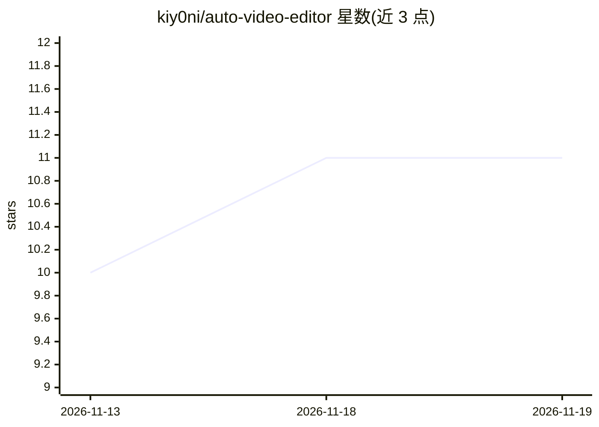

# kiy0ni/auto-video-editor

⭐ 11 · Python · MIT · 推送 2026-10-26 · [GitHub](https://github.com/kiy0ni/auto-video-editor) · 个人维护

**为视频创作者自动生成集锦短片与竖版字幕短视频**

读取长录像（直播/VOD/播客/游戏），自动完成语音识别、精彩时刻检测、竖版裁切与字幕烧录，输出 16:9 集锦、TikTok/Shorts 竖版视频，以及 EDL/XML/SRT/章节等可导入 Premiere Pro、DaVinci Resolve、Avid 的交接文件。默认全自动：自动识别内容风格、语音模型、语言、词表包与摄像头区域，每项可手动覆盖。本地运行，依赖 Python 3.9+ 与 FFmpeg；语音引擎 faster-whisper 为强烈推荐而非硬性依赖。提供桌面应用与 CLI。

## 筛选速览

| 维度 | 判定 | 备注 |
|---|---|---|
| AI 角色 | `ai-native` | 本体是模型或模型工具 |
| 许可风险 | `permissive` | MIT |
| 部署形态 | `library` | 以包/库形式分发 |
| 模型依赖 | — | README 未给出锁定关系 |
| 硬件要求 | — | 无带数字的原话,不猜 |
| 安装摩擦 | `medium` | 含编译或系统依赖之一 |
| 成熟度 | — | 结构信号不足 |

## 能力要点

- 全自动分析：风格、语言、语音模型、词表包、竖版布局均可自动判定并覆盖
- 100+ 游戏与话题词汇包提升转写质量，支持自定义词包
- 摄像头感知的竖版布局（模糊/裁切/人脸跟踪/分屏）与卡拉OK式字幕
- EDL、FCP7 XML、SRT、YouTube 章节、缩略图与标题建议的发布套件

## 适用场景

- 把直播录像一键剪成集锦和竖版短视频
- 批量处理大量 VOD 并导出时间线到剪辑软件
- 为播客生成逐句字幕与多说话人标注

## 场景标签

`语音识别` `视频生成` `图像视频处理` · 领域:内容生成

## 证据(README 行号)

> L5: Turn a long recording (Twitch/YouTube stream, VOD, podcast, gameplay session) into:
> L11: Everything runs locally: FFmpeg for audio/video, Whisper for speech recognition.
> L13: **Fully automatic by default.** Drop a video and click *Create*: the app looks at the picture, listens to a

## 星数曲线

2026-11-13 10 → 2026-11-19 11（+1）

---
*卡片 v1 · prompt 1.4 · 生成 2026-11-18 · 置信度 high · 依据 README sha `61643c260f7e` · [字段定义](../../DATASET.md)*
