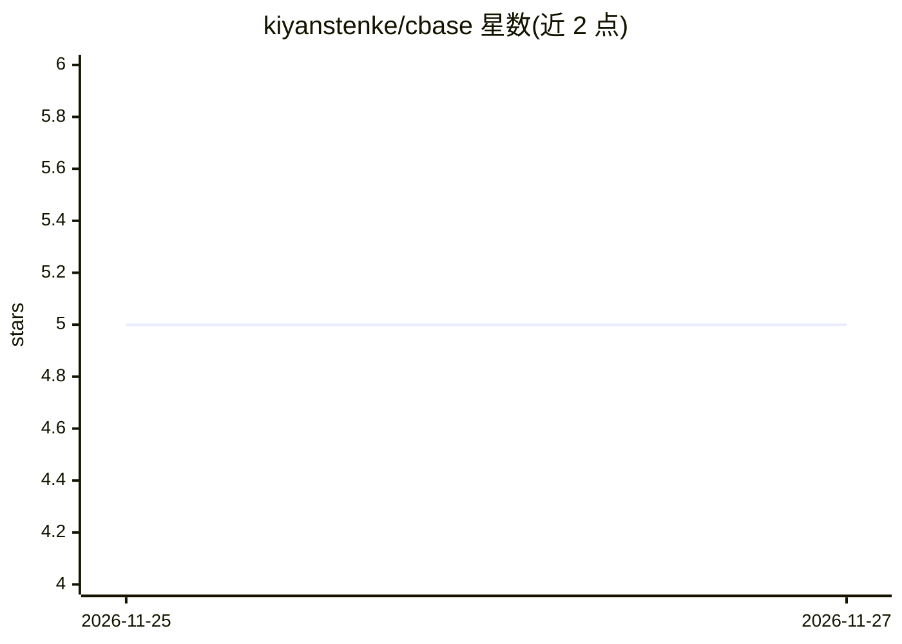

# kiyanstenke/cbase

⭐ 5 · JavaScript · AGPL-3.0 · 推送 2026-11-26 · [GitHub](https://github.com/kiyanstenke/cbase) · 个人维护

**自托管工作台：在隔离容器中长时运行 coding agents**

自托管的编码代理工作台，将 Claude Code、Codex 与 OpenRouter 模型各自运行在独立容器中，会话在用户断开后继续执行。提供 web UI、macOS 桌面应用与 iOS 客户端（含推送通知），支持文件编辑器、终端、Git 视图、定时任务、工作流与用户容器管理。网关为单租户进程，多租户依赖容器边界；各用户在容器内使用自己的订阅或 API key，cbase 不代理登录。当前为 pre-1.0，无稳定性保证。

## 筛选速览

| 维度 | 判定 | 备注 |
|---|---|---|
| AI 角色 | `ai-ecosystem` | LLM/agent 周边工具 |
| 许可风险 | `viral` | AGPL-3.0 |
| 部署形态 | `self-host` | docker 或自建部署 |
| 模型依赖 | locked-api |  |
| 硬件要求 | — | 无带数字的原话,不猜 |
| 安装摩擦 | `low` | 无编译、无系统依赖或容器化 |
| 成熟度 | `idea` | |

## 能力要点

- 每个用户/项目一个独立容器，含独立 Docker daemon（需 Sysbox）
- 通过官方 CLI 固定版本接入 Claude Code 与 Codex，内置 OpenRouter 引擎
- 定时任务、图/脚本工作流与聊天间通道
- web/macOS/iOS 三端客户端，支持英语与德语

## 适用场景

- 让编码 agent 在服务器上长时间运行，手机上审批与查看
- 团队每人独立容器与凭据地使用各自的模型订阅
- 以定时任务和工作流方式运行 agent 作业

## 场景标签

`编码 Agent` · 领域:编码与开发

## 证据(README 行号)

> L5: **A self-hosted workbench for long-running coding agents.** Let Claude Code, Codex and OpenRouter models work for ho
> L15: - **Agents** — Claude Code and Codex through their official CLIs (pinned versions), OpenRouter models through a bui
> L23: - **Operation** — a gateway with user management, one long-lived container per user with its own limits, idle stop,

## 星数曲线

2026-11-25 5 → 2026-11-27 5（+0）

---
*卡片 v1 · prompt 1.4 · 生成 2026-11-24 · 置信度 mid · 依据 README sha `33d89a824a55` · [字段定义](../../DATASET.md)*
