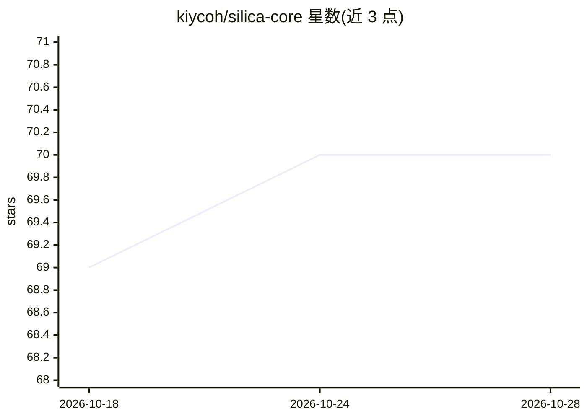

# kiycoh/silica-core

⭐ 70 · Python · MIT · 推送 2026-10-27 · [GitHub](https://github.com/kiycoh/silica-core) · 个人维护

**面向编码 agent 的本地证据检索工具，经 MCP 提供文件/搜索/读取等工具**

Silica Core 在单个根目录下索引 markdown、代码、PDF 与办公文档，通过 MCP 或 shell 命令向 Claude Code、Cursor、Codex 等编码 agent 提供五个检索工具（files/search/read/code_pack/write_note），返回路径、章节、行号与文本窗口。检索分 BM25 词法与静态嵌入向量（potion-retrieval-32M，无 torch/GPU）两路融合，输出 coverage、terms_absent 等信号供 harness 判断结果可信度。无需 API key，数据不出本机；0.10.0 起 `silica` 命令更名为 `silica-core`。

## 筛选速览

| 维度 | 判定 | 备注 |
|---|---|---|
| AI 角色 | `ai-ecosystem` | LLM/agent 周边工具 |
| 许可风险 | `permissive` | MIT |
| 部署形态 | `library` | 以包/库形式分发 |
| 模型依赖 | — | README 未给出锁定关系 |
| 硬件要求 | — | 无带数字的原话,不猜 |
| 安装摩擦 | `medium` | 含编译或系统依赖之一 |
| 成熟度 | — | 结构信号不足 |

## 能力要点

- 五件工具：silica_files/search/read/code_pack/write_note，命中含路径、行号、coverage 等信号
- BM25 词法 + 静态 model2vec 向量双路混合检索，无需 torch/GPU 与 API key
- 支持 20+ 编码客户端注册（claude/codex/cursor/zed 等），提供 Claude Code 插件一键安装
- 代码树中函数/类/常量各为检索单元，code_pack 按字符预算生成 AST 上下文

## 适用场景

- 给编码 agent 配备本地代码与文档检索工具，替代翻找文件
- 让 agent 回答问题时携带文件、页码与行号出处
- 对本地 PDF 论文库做问答检索

## 场景标签

`语义搜索` · 领域:知识与检索

## 证据(README 行号)

> L11: serves them to Claude Code, Cursor, Hermes, Codex, OpenCode and every other popular harness, as MCP tools or as she
> L18: harness calls `silica_search`, and the answer carries the file, the page and
> L163: Every written block, and the Claude Code plugin, run `silica-core mcp --retrieval

## 星数曲线

2026-10-18 69 → 2026-10-28 70（+1）

---
*卡片 v1 · prompt 1.4 · 生成 2026-10-24 · 置信度 mid · 依据 README sha `cf59522661e6` · [字段定义](../../DATASET.md)*
