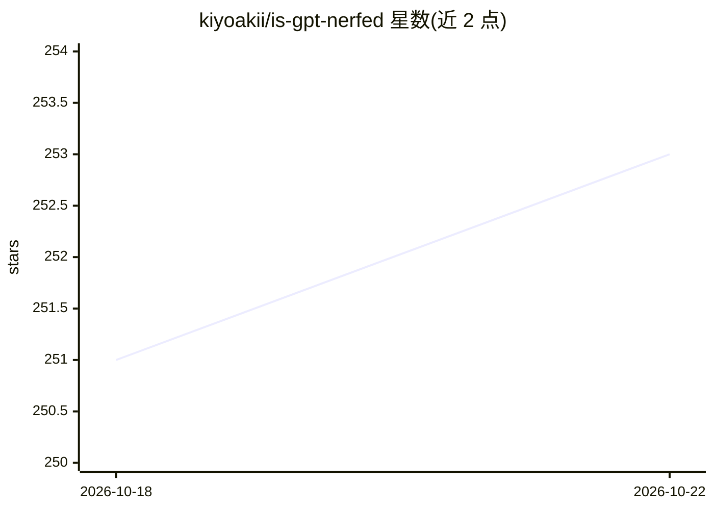

# kiyoakii/is-gpt-nerfed

⭐ 253 · Python · MIT · 推送 2026-09-29 · [GitHub](https://github.com/kiyoakii/is-gpt-nerfed) · 个人维护 · 中文 README

**检测 Codex 实际应答模型是否被偷换的 macOS 工具**

macOS 菜单栏应用加 Codex 插件：读取 Codex 每轮会话记录（请求的模型、推理力度、上下文窗口），标记未经用户操作发生的变化；并按计划临时分叉会话请求约 300 个"随机"数字，用 ModelTrace 校准指纹库比对应答模型是否与所选一致，输出 Match/Suspicious/Nerfed 等判定，通过 macOS 通知与菜单栏红脸提示。全部在本地运行，探测消耗三次短回答。限制：指纹库为闭集，改名换权重只能靠指纹或上下文窗口发现；需 macOS 15+ 与 Codex 0.154+（含插件 hooks）。

## 筛选速览

| 维度 | 判定 | 备注 |
|---|---|---|
| AI 角色 | `ai-ecosystem` | LLM/agent 周边工具 |
| 许可风险 | `permissive` | MIT |
| 部署形态 | `None` |  |
| 模型依赖 | — | README 未给出锁定关系 |
| 硬件要求 | — | 无带数字的原话,不猜 |
| 安装摩擦 | `low` | 无编译、无系统依赖或容器化 |
| 成熟度 | — | 结构信号不足 |

## 能力要点

- 读取 Codex 会话记录检测静默模型切换、推理力度降低与隐藏内部模型
- 通过分叉会话的随机数回答生成模型指纹并与所选模型比对
- 菜单栏面板列出 48 小时内会话及其最新判定，另提供 CLI（nerfed probe/report/log）
- 全部本地运行，自身网络请求仅为 GitHub 版本检查，可关闭

## 适用场景

- 我在 Codex 里选了某模型，想知道实际应答的是不是它
- 追踪会话期间是否被降级到更小或隐藏的内部模型
- 多账号切换后重新核验各会话的模型判定

## 场景标签

 · 领域:LLM 监控/开发者工具

## 证据(README 行号)

> L21: Codex records, for every turn, which model and reasoning effort it asked for. The plugin reads those records after
> L29: model. ModelTrace's calibrated bank turns the three answers into a

## 星数曲线

2026-10-18 251 → 2026-10-22 253（+2）

---
*卡片 v1 · prompt 1.4 · 生成 2026-10-22 · 置信度 high · 依据 README sha `e4d5341ef63e` · [字段定义](../../DATASET.md)*
