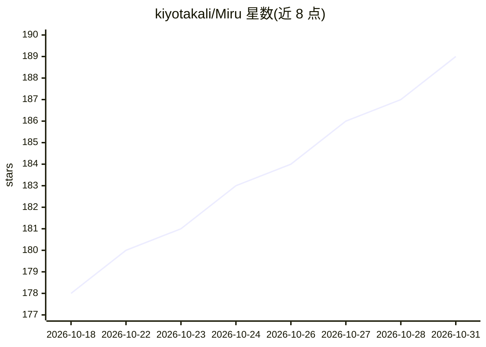

# kiyotakali/Miru

⭐ 189 · Python · Apache-2.0 · 推送 2026-10-13 · [GitHub](https://github.com/kiyotakali/Miru) · [官网](https://mirulife.top/) · 个人维护 · 中文 README

**自托管的 Live2D AI 桌宠伴侣：本地运行、长期记忆、主动陪伴**

Miru 是一个自托管的 AI 陪伴应用：以 Live2D 角色形式驻留在桌面，通过屏幕传感器（默认每 30 秒、可关）理解用户正在做什么，将截图分析后丢弃、仅保留事实，写入四类长期记忆（项目/人物/自我/话题）、每日日志与承诺清单，记忆以 Markdown 文件存储、可打开导出。注意力系统决定何时主动开口。用户自带 OpenAI 兼容的模型 API key（Vision/Chat/Memory 三层可混用不同提供方）。支持 macOS/Windows/Android 本地单机或部署到自己的 Linux 服务器（Docker 镜像）实现多设备同步。核心后端为 Flask。

## 筛选速览

| 维度 | 判定 | 备注 |
|---|---|---|
| AI 角色 | `ai-native` | 本体是模型或模型工具 |
| 许可风险 | `permissive` | Apache-2.0 |
| 部署形态 | `None` |  |
| 模型依赖 | — | README 未给出锁定关系 |
| 硬件要求 | — | 无带数字的原话,不猜 |
| 安装摩擦 | `low` | 无编译、无系统依赖或容器化 |
| 成熟度 | — | 结构信号不足 |

## 能力要点

- 长期记忆为纯 Markdown 文件，可打开、读取、导出与审计
- 屏幕传感器默认每 30 秒读取屏幕，截图分析后即丢弃，仅保留理解结果
- 三层模型（Vision/Chat/Memory）均为 OpenAI 兼容接口，可混用不同提供方
- 本地单机或自有 Linux 服务器部署，多设备通过邀请码同步同一记忆

## 适用场景

- 在桌面养一个会记住我日常的 Live2D AI 伴侣
- 跨 Mac/Windows/Android 多设备保持同一份记忆同步
- 数据不出本机地运行 AI 陪伴，并自行审计其记忆内容

## 场景标签

`聊天机器人` `Agent 记忆` `AI 助手` · 领域:Agent 开发

## 证据(README 行号)

> L24: **Miru** is 見る — Japanese for *to see*. Spell it out and it says something else: **M**emory, **I** **R**emember **U
> L30: - **She decides when to speak.** An attention system reads your screen and your rhythm and judges the moment. Deep 
> L74: - **Three model tiers**, all OpenAI-compatible: `Vision` (reads screenshots), `Chat` (talks to you), `Memory` (orga

## 星数曲线

2026-10-18 178 → 2026-10-31 189（+11）

---
*卡片 v1 · prompt 1.4 · 生成 2026-10-22 · 置信度 high · 依据 README sha `7aabf18091aa` · [字段定义](../../DATASET.md)*
