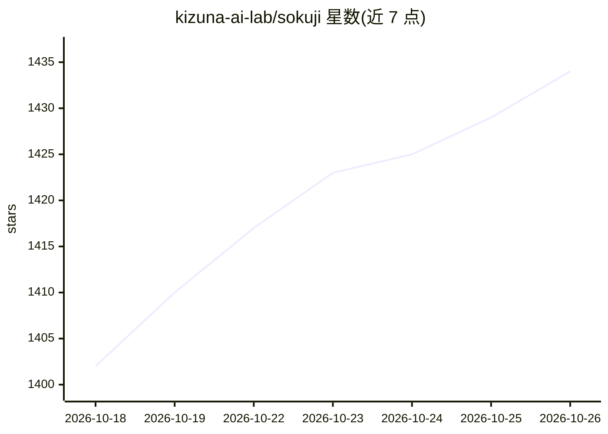

# kizuna-ai-lab/sokuji

⭐ 1,434 · TypeScript · AGPL-3.0 · 推送 2026-10-25 · [GitHub](https://github.com/kizuna-ai-lab/sokuji) · [官网](https://sokuji.kizuna.ai) · 组织维护 · 中文 README

**双语会议实时双向语音翻译应用，云端或本地离线可用**

面向会议参与者的跨平台实时语音翻译应用，提供桌面版（Electron）与浏览器扩展（Chrome/Edge）。自动检测说话语言并双向翻译，支持麦克风与系统音频同采、实时字幕、虚拟麦克风路由到 Zoom/Meet/Teams 等应用。可接入 8 家云服务商（OpenAI、Gemini、Palabra.ai、Doubao AST 2.0、Soniox 等），或本地推理：基于 WASM 与 WebGPU 在设备上运行 ASR（44 模型）、翻译（75 模型）与 TTS（137 模型），无需 API key 与 GPU。许可证为 AGPL-3.0。

## 筛选速览

| 维度 | 判定 | 备注 |
|---|---|---|
| AI 角色 | `ai-native` | 本体是模型或模型工具 |
| 许可风险 | `viral` | AGPL-3.0 |
| 部署形态 | `desktop` | 安装包/桌面程序 |
| 模型依赖 | — | README 未给出锁定关系 |
| 硬件要求 | `cpu-ok` | |
| 安装摩擦 | `low` | 无编译、无系统依赖或容器化 |
| 成熟度 | — | 结构信号不足 |

## 能力要点

- 本地推理：44 ASR / 75 翻译 / 137 TTS 模型在设备上经 WASM+WebGPU 运行，无需 API key 与 GPU
- 自动语言检测的双向翻译，麦克风与系统音频同采，支持 60+ 语言（Soniox 双向模式）
- 桌面版与浏览器扩展功能一致，虚拟麦克风可路由到任意会议应用
- 云模式直连服务商 API，密钥仅本地存储

## 适用场景

- 与外语伙伴开双语会议，实时双向翻译并显示字幕
- 在 Zoom/Meet/Teams 中把翻译后的语音经虚拟麦克风传给对方
- 无网络或隐私敏感场景下完全离线完成语音识别、翻译与合成

## 场景标签

 · 领域:语音翻译/会议工具

## 证据(README 行号)

> L25: Sokuji is a cross-platform live speech translation app for desktop and browser. It supports **Local Inference** — o
> L98: Two people, two languages, one conversation. Sokuji auto-detects which
> L133: |**Local Inference**|Fully offline · ASR → Translation → TTS on-device · no API key · no GPU required|

## 星数曲线

2026-10-18 1,402 → 2026-10-26 1,434（+32）

---
*卡片 v1 · prompt 1.4 · 生成 2026-10-21 · 置信度 mid · 依据 README sha `e4a147214a47` · [字段定义](../../DATASET.md)*
