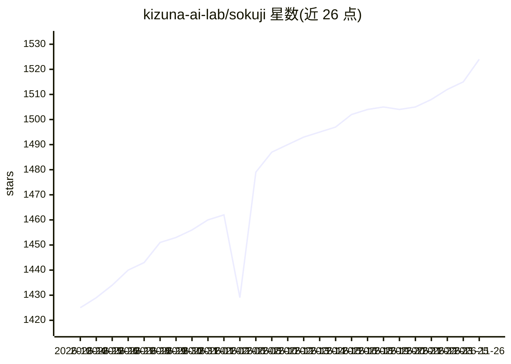

# kizuna-ai-lab/sokuji

⭐ 1,524 · TypeScript · AGPL-3.0 · 推送 2026-11-25 · [GitHub](https://github.com/kizuna-ai-lab/sokuji) · [官网](https://sokuji.kizuna.ai) · 组织维护

**为双语会议提供实时双向语音翻译的桌面与浏览器应用**

Sokuji 是跨平台实时语音翻译应用，提供桌面版（Electron）与浏览器扩展两种形态。核心机制：自动检测说话语言并在两种语言间双向翻译，同时采集麦克风与系统音频，输出实时字幕与翻译后语音（虚拟麦克风路由）。支持本地推理（WASM/WebGPU 上运行 ASR→翻译→TTS，离线无需 API key）与 8 个云服务商接入。桌面版覆盖 Windows/macOS/Linux 安装包，也可从源码构建。

## 筛选速览

| 维度 | 判定 | 备注 |
|---|---|---|
| AI 角色 | `ai-native` | 本体是模型或模型工具 |
| 许可风险 | `viral` | AGPL-3.0 |
| 部署形态 | `desktop` | 安装包/桌面程序 |
| 模型依赖 | — | README 未给出锁定关系 |
| 硬件要求 | `cpu-ok` | |
| 安装摩擦 | `low` | 无编译、无系统依赖或容器化 |
| 成熟度 | — | 结构信号不足 |

## 能力要点

- 自动检测语言的双向实时翻译（Soniox two-way 模式，60+ 语言）
- 本地推理：44 ASR + 75 翻译 + 137 TTS 模型，完全离线、无需 API key、无需 GPU
- 支持 OpenAI、Gemini、Palabra.ai、Doubao、Soniox 等云服务商及任意 OpenAI 兼容端点
- 虚拟麦克风将翻译音频路由至 Zoom、Meet、Teams 等任意应用

## 适用场景

- 双语会议中让双方各自听到母语翻译
- 无网络环境下离线进行语音翻译
- 直播或录屏时为观众提供实时翻译字幕
- 在浏览器内的会议平台中直接使用翻译

## 场景标签

`语音 Agent` `语音识别` `语音合成` · 领域:对话与助手

## 证据(README 行号)

> L25: Sokuji is a cross-platform live speech translation app for desktop and browser. It supports **Local Inference** — o
> L98: Two people, two languages, one conversation. Sokuji auto-detects which
> L113: ### Local Inference (Edge AI)

## 星数曲线

2026-10-24 1,425 → 2026-11-26 1,524（+99）

---
*卡片 v1 · prompt 1.4 · 生成 2026-11-23 · 置信度 high · 依据 README sha `f47d1c9dbe66` · [字段定义](../../DATASET.md)*
