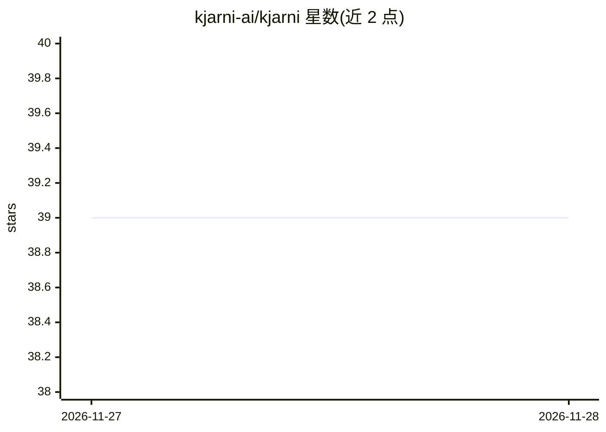

# kjarni-ai/kjarni

⭐ 39 · Rust · Apache-2.0 · 推送 2026-11-27 · [GitHub](https://github.com/kjarni-ai/kjarni) · [官网](https://kjarni.ai) · 个人维护

**让开发者在本机进程内运行 transformer 推理的多语言引擎**

用 Rust 从零实现的 transformer 推理库，以单一共享库形式在 Python、C#、Go、C++、Rust 与浏览器（WASM）中提供 embeddings、分类、重排、混合检索、聊天、语音转写、摘要、翻译与图像检索能力，各绑定封装同一 C ABI，输出一致。模型首次使用时自动下载并缓存，之后可完全离线运行；pip 安装无任何依赖，不带 PyTorch/ONNX Runtime。另提供 OpenAI 兼容格式的 HTTP 服务器（kjarni serve）与面向 MCP 客户端的工具服务（kjarni mcp）。

## 筛选速览

| 维度 | 判定 | 备注 |
|---|---|---|
| AI 角色 | `ai-ecosystem` | LLM/agent 周边工具 |
| 许可风险 | `permissive` | Apache-2.0 |
| 部署形态 | `library` | 以包/库形式分发 |
| 模型依赖 | — | README 未给出锁定关系 |
| 硬件要求 | `cpu-ok` | |
| 安装摩擦 | `high` | 编译与系统依赖俱全 |
| 成熟度 | — | 结构信号不足 |

## 能力要点

- 六种语言绑定共用同一 C ABI，输出逐字节一致
- pip 安装零依赖（无 PyTorch/ONNX Runtime/numpy），28 MB 安装体积
- 提供 OpenAI 兼容格式的本地 HTTP API 与 MCP 工具服务
- 支持内置 BM25+向量混合检索与 cross-encoder 重排

## 适用场景

- 在 .NET 或 Go 应用中加入语义检索或分类而不引入 Python 服务
- 数据不能外传的场景（法律/医疗/金融）本地运行推理
- 为 Claude Code、Cursor 等 MCP 客户端提供本地搜索/转写工具
- 在浏览器标签页内直接运行嵌入与聊天

## 场景标签

`语义搜索` `语音识别` `推理引擎` · 领域:知识与检索

## 证据(README 行号)

> L14: Kjarni is a transformer inference library: local AI inference as one native engine for Python, C#, Go, C++, Rust an
> L268: A request picks its model by Kjarni name, and each model loads on its first request and stays loaded. Without a mo

## 星数曲线

2026-11-27 39 → 2026-11-28 39（+0）

---
*卡片 v1 · prompt 1.4 · 生成 2026-11-27 · 置信度 high · 依据 README sha `31673e06bad7` · [字段定义](../../DATASET.md)*
