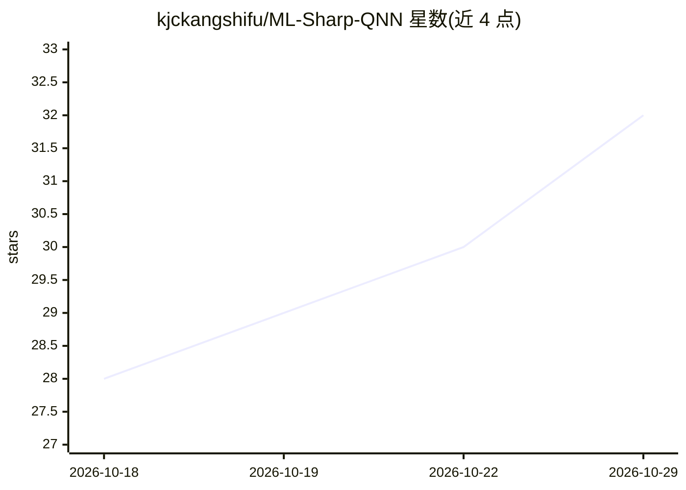

# kjckangshifu/ML-Sharp-QNN

⭐ 32 · C++ · GPL-3.0 · 推送 2026-09-25 · [GitHub](https://github.com/kjckangshifu/ML-Sharp-QNN) · [官网](https://github.com/kjckangshifu/ML-Sharp-QNN) · 个人维护 · 中文 README

**将苹果 SHARP 单图 3D 高斯泼溅移植到骁龙手机离线运行的安卓应用**

面向 Snapdragon 设备的 Android 应用：把 Apple SHARP 单图 3D 重建模型移植到高通 QNN HTP（Hexagon DSP）上，实现全离线推理。用户选择一张照片即生成 .ply 格式的 3D 高斯泼溅文件。支持从 HuggingFace（国内可切 HF-Mirror）一键下载预转换 W8A16 DLC 模型，读取 EXIF 焦距辅助深度估计，无 EXIF 时用 AnyCalib 估算焦距。另附 build_rest_pipeline.py 完整模型转换管线（PyTorch→ONNX→量化 DLC）。限制：需 SD 8 Gen 2 及以上、Android 12+，无预编译 APK 需自行用 Gradle 构建。

## 筛选速览

| 维度 | 判定 | 备注 |
|---|---|---|
| AI 角色 | `ai-native` | 本体是模型或模型工具 |
| 许可风险 | `viral` | GPL-3.0 |
| 部署形态 | `None` |  |
| 模型依赖 | — | README 未给出锁定关系 |
| 硬件要求 | — | 无带数字的原话,不猜 |
| 安装摩擦 | `low` | 无编译、无系统依赖或容器化 |
| 成熟度 | — | 结构信号不足 |

## 能力要点

- 单图到 3D 高斯泼溅（.ply），全离线运行于 Hexagon DSP
- QNN HTP 上加载多精度 DLC 模型（W8A16）
- EXIF 焦距读取 + AnyCalib AI 焦距估算
- PyTorch→ONNX→量化 DLC 的端到端模型转换管线

## 适用场景

- 在骁龙手机上离线将单张照片转为 3D 模型
- 复现/分发 SHARP 模型的 QNN 量化版本
- 研究端侧 NPU 上 3D 高斯泼溅的部署

## 场景标签

 · 领域:移动端 3D 视觉/边缘 AI

## 证据(README 行号)

> L12: **SHARP QNN** is an Android app that brings Apple's SHARP — single-image 3D Gaussian Splatting — to Snapdragon-powe
> L25: - **Single image → 3D Gaussian Splat** — pick a photo, get a `.ply` file
> L24: - **Fully offline** — no cloud, no API calls, everything runs on the Hexagon DSP

## 星数曲线

2026-10-18 28 → 2026-10-29 32（+4）

---
*卡片 v1 · prompt 1.4 · 生成 2026-10-26 · 置信度 high · 依据 README sha `60776c74ff15` · [字段定义](../../DATASET.md)*
