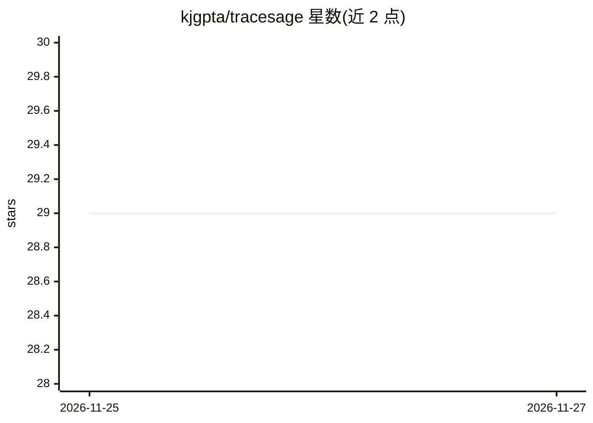

# kjgpta/tracesage

⭐ 29 · Python · Apache-2.0 · 推送 2026-11-23 · [GitHub](https://github.com/kjgpta/tracesage) · [官网](https://kjgpta.github.io/tracesage/) · 个人维护

**给 LLM agent 与 AI 助手会话做本地化观测追踪的工具**

本地优先的可观测性工具：通过一行回调或 instrument 参数捕获 LangChain/LangGraph、Pydantic AI、OpenAI Agents SDK、CrewAI 及任意 OpenTelemetry 来源的运行轨迹，持久化到本地 SQLite，并在浏览器中以交互图与时间线实时渲染；失败的工具调用会在对应步骤标红并显示输入与错误。`tracesage connect` 还可读取本机 Claude Desktop、Claude Code、Cursor、Codex 的会话并转为完整 trace。安装即用，无 Docker/Postgres/外部服务，数据不离开本机；需 Python 3.11+。

## 筛选速览

| 维度 | 判定 | 备注 |
|---|---|---|
| AI 角色 | `ai-ecosystem` | LLM/agent 周边工具 |
| 许可风险 | `permissive` | Apache-2.0 |
| 部署形态 | `library` | 以包/库形式分发 |
| 模型依赖 | — | README 未给出锁定关系 |
| 硬件要求 | — | 无带数字的原话,不猜 |
| 安装摩擦 | `low` | 无编译、无系统依赖或容器化 |
| 成熟度 | — | 结构信号不足 |

## 能力要点

- pip 安装即用，无 Docker/Postgres/外部服务，UI 离线可用
- 支持 LangChain/LangGraph、Pydantic AI、OpenAI Agents SDK、CrewAI 及任意 OTLP 来源接入
- connect 可导入 Claude Desktop、Claude Code、Cursor、Codex 本地会话为 trace
- 提供 tracesage show/watch/diff/view 终端调试命令与 pytest fixture

## 适用场景

- 调试 agent 运行失败时定位出错的具体工具调用
- 查看 AI 助手（如 Claude Code/Cursor）每次会话背后的模型与工具调用
- 在浏览器中回放、对比多次 agent 运行的耗时与 token 用量
- 将本地 trace 以 OpenTelemetry 格式导出到既有观测栈

## 场景标签

`LLM 可观测性` · 领域:评测与运维

## 证据(README 行号)

> L6: Local-first observability for LangChain / LangGraph, Pydantic AI, OpenAI Agents SDK, CrewAI
> L92: - **Zero infrastructure.** No Docker. No Postgres. No external services. `pip install`.
> L225: tracesage is **provider-agnostic** — it traces LangChain's callback stream, so

## 星数曲线

2026-11-25 29 → 2026-11-27 29（+0）

---
*卡片 v1 · prompt 1.4 · 生成 2026-11-24 · 置信度 high · 依据 README sha `acab8e1b5c2f` · [字段定义](../../DATASET.md)*
