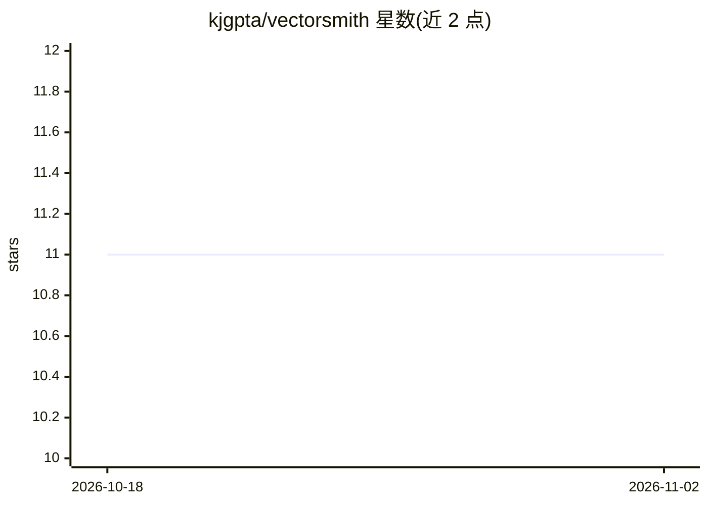

# kjgpta/vectorsmith

⭐ 11 · Python · Apache-2.0 · 推送 2026-10-01 · [GitHub](https://github.com/kjgpta/vectorsmith) · [官网](https://kjgpta.github.io/vectorsmith/) · 个人维护

**把向量数据库编译成类型化 agent 工具的 YAML 框架**

开发者编写 tools.yaml 声明工具（search/lookup/count/scroll/pipeline），VectorSmith 将其编译为带类型参数、枚举与隐藏租户过滤的工具，供 Python 进程内 load_tools 或通过 MCP serve 暴露给 Claude Desktop/Code、Codex、Cursor。支持 Qdrant、pgvector、Chroma、Pinecone、Weaviate、Milvus 六种后端（均标注 experimental），0.2.0 起提供生产 HTTP 模式（JWT/OAuth 认证、限流、OTLP 观测、RBAC）。以 pip 包 + CLI 形式提供，需 Python 3.10+。

## 筛选速览

| 维度 | 判定 | 备注 |
|---|---|---|
| AI 角色 | `ai-ecosystem` | LLM/agent 周边工具 |
| 许可风险 | `permissive` | Apache-2.0 |
| 部署形态 | `library` | 以包/库形式分发 |
| 模型依赖 | locked-api |  |
| 硬件要求 | — | 无带数字的原话,不猜 |
| 安装摩擦 | `low` | 无编译、无系统依赖或容器化 |
| 成熟度 | `idea` | |

## 能力要点

- tools.yaml 编译为 MCP schema 或进程内工具，隐藏租户过滤与凭据
- 六种向量数据库适配（均实验状态），确定性一致性测试矩阵
- 生产 HTTP 模式：JWT/api_key/OAuth、RBAC、限流、OTLP 可观测性
- LangChain/LangGraph/OpenAI Agents/Anthropic 多框架集成

## 适用场景

- 让 Claude/Cursor/Codex 通过 MCP 安全查询我的业务向量数据
- 在 LangChain/LangGraph agent 中以类型化工具接入 Qdrant 等向量库
- 多租户场景下对 agent 隐藏租户过滤与凭据

## 场景标签

`Agent 框架` · 领域:Agent 开发

## 证据(README 行号)

> L7: Write a `tools.yaml`. VectorSmith compiles it into typed, tenant-guarded tools — then you either `import` them in Py
> L59: |Call|`from vectorsmith import load_tools`|`vectorsmith serve tools.yaml --name invoices`|
> L143: Those products cannot `import vectorsmith`. They spawn a process. Point them at `serve` with the **same YAML**.

## 星数曲线

2026-10-18 11 → 2026-11-02 11（+0）

---
*卡片 v1 · prompt 1.4 · 生成 2026-11-02 · 置信度 high · 依据 README sha `3e8f086380cd` · [字段定义](../../DATASET.md)*
