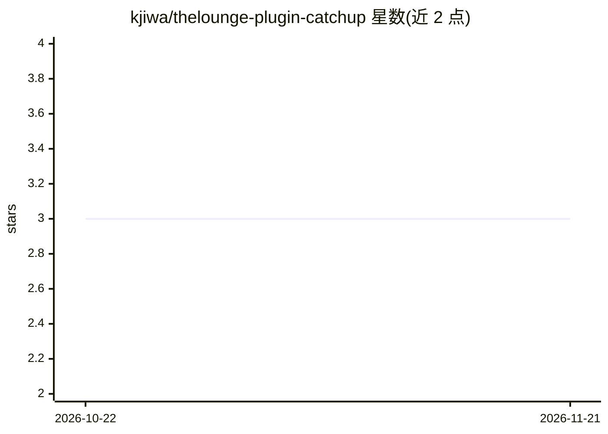

# kjiwa/thelounge-plugin-catchup

⭐ 3 · JavaScript · MIT · 推送 2026-11-17 · [GitHub](https://github.com/kjiwa/thelounge-plugin-catchup) · [官网](https://www.npmjs.com/package/thelounge-plugin-catchup) · 个人维护

**The Lounge IRC 插件：按需用 LLM 总结频道错过的消息**

作为 The Lounge 的插件运行，用户在频道内执行 /summarize 或 /ask 命令，插件读取 sqlite 消息日志中指定时间窗口（如 6h、today、某日）的聊天记录，交给用户自配置的 LLM 生成总结或带 nick 与时间引用的问答；回复仅发送给发起命令的用户本人。支持 bedrock、anthropic、openai-compatible、lambda 四种 provider，输出含 OVERVIEW/TOPICS/POSITIONS、MENTIONS 与 GAPS 区块。要求 Node.js 22.17+、The Lounge 4.5.2+ 且开启 sqlite 日志。

## 筛选速览

| 维度 | 判定 | 备注 |
|---|---|---|
| AI 角色 | `ai-enhanced` | 去掉 AI 部分产品仍成立 |
| 许可风险 | `permissive` | MIT |
| 部署形态 | `None` |  |
| 模型依赖 | local-ok | 支持本地模型 |
| 硬件要求 | — | 无带数字的原话,不猜 |
| 安装摩擦 | `low` | 无编译、无系统依赖或容器化 |
| 成熟度 | — | 结构信号不足 |

## 能力要点

- /summarize 支持多种时间窗口并可聚焦指定用户的发言
- /ask 基于窗口内日志回答问题并引用 nick 与时间
- 支持 bedrock/anthropic/openai-compatible/lambda 四类 provider
- 回复仅出现在发起命令的用户客户端，插件不存储数据

## 适用场景

-  IRC 频道离线后回看错过了哪些讨论
- 就某时间段聊天内容向日志提问
- 聚焦查看某人这段时间说了什么

## 场景标签

`文档问答` · 领域:知识与检索

## 证据(README 行号)

> L3: Summarizes what you missed in IRC channels on The Lounge, on demand and only in your own client, using the LLM you c
> L86: |`provider`|Required. `bedrock`, `anthropic`, `openai-compatible` or `lambda`.|
> L159: - Message logging to sqlite (`messageStorage: ["sqlite"]` and a user with logs enabled). Text-only logging is not 

## 星数曲线

2026-10-22 3 → 2026-11-21 3（+0）

---
*卡片 v1 · prompt 1.4 · 生成 2026-11-21 · 置信度 high · 依据 README sha `7bdac6a6f760` · [字段定义](../../DATASET.md)*
