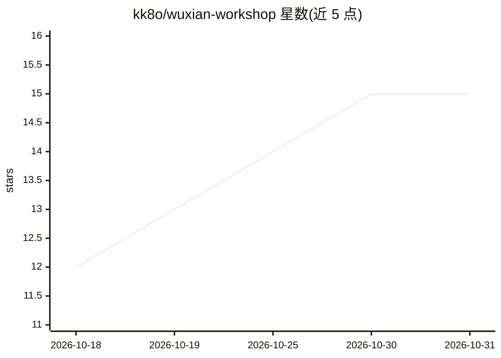

# kk8o/wuxian-workshop

⭐ 15 · Python · MIT · 推送 2026-10-27 · [GitHub](https://github.com/kk8o/wuxian-workshop) · [官网](https://wuxianwow.com/workshop) · 个人维护 · 中文 README

**让 AI Agent 编写并调试魔兽世界插件的本地 MCP 工具**

运行在 Windows 10/11（64 位）的本机服务与桌面程序，提供 HTTP + MCP 接口（仅监听 127.0.0.1），让 Claude Code、Codex、Cursor 等支持 MCP 的 Agent 编写、检查、热加载《魔兽世界：无限》插件，并在运行中的游戏里执行 Lua、读回报错、print 输出与截图。App 与游戏通过屏幕帧码与字体文件通信，不读内存、不注入代码。需 Python 3.14 与 WebView2 运行时，从源码运行，含游戏内开发组件插件与 API 手册数据。

## 筛选速览

| 维度 | 判定 | 备注 |
|---|---|---|
| AI 角色 | `ai-ecosystem` | LLM/agent 周边工具 |
| 许可风险 | `permissive` | MIT |
| 部署形态 | `desktop` | 安装包/桌面程序 |
| 模型依赖 | — | README 未给出锁定关系 |
| 硬件要求 | — | 无带数字的原话,不猜 |
| 安装摩擦 | `low` | 无编译、无系统依赖或容器化 |
| 成熟度 | — | 结构信号不足 |

## 能力要点

- MCP 接口供 Agent 调用：代码检查、热加载、游戏内执行 Lua、读日志与截图
- App 与游戏间用屏幕帧码与字体文件通信，不读内存、不注入代码
- Lua 5.1 语法与客户端 API 检查、事件录制、框体查询、历史版本回退
- 内置该客户端的 API 手册数据（函数、事件、枚举、taint 规矩）

## 适用场景

- 让 AI Agent 从零写魔兽插件或修改已装插件
- 插件写完直接在运行中的游戏里试错、看报错和截图调试
- 对照客户端专属 API 手册排查函数与事件用法

## 场景标签

 · 领域:游戏开发工具

## 证据(README 行号)

> L5: 无限工坊让你的 AI Agent（Claude Code、Codex、Cursor、Trae、WorkBuddy 等支持 MCP 的 Agent）自己写《魔兽世界：无限》插件、自己调试：从零写一个
> L18: |无限工坊 App|`src/wuxianworkshop/`|本机服务（HTTP + MCP，只监听 127.0.0.1）、桌面窗口与托盘、命令行 `wuxian`、安装与自检|
> L20: |你的 AI Agent|你自己的|通过 MCP 调用 App：检查代码、热加载、在游戏里试、读日志与截图、查 API 手册|

## 星数曲线

2026-10-18 12 → 2026-10-31 15（+3）

---
*卡片 v1 · prompt 1.4 · 生成 2026-10-30 · 置信度 mid · 依据 README sha `a13c1dbaf8a7` · [字段定义](../../DATASET.md)*
