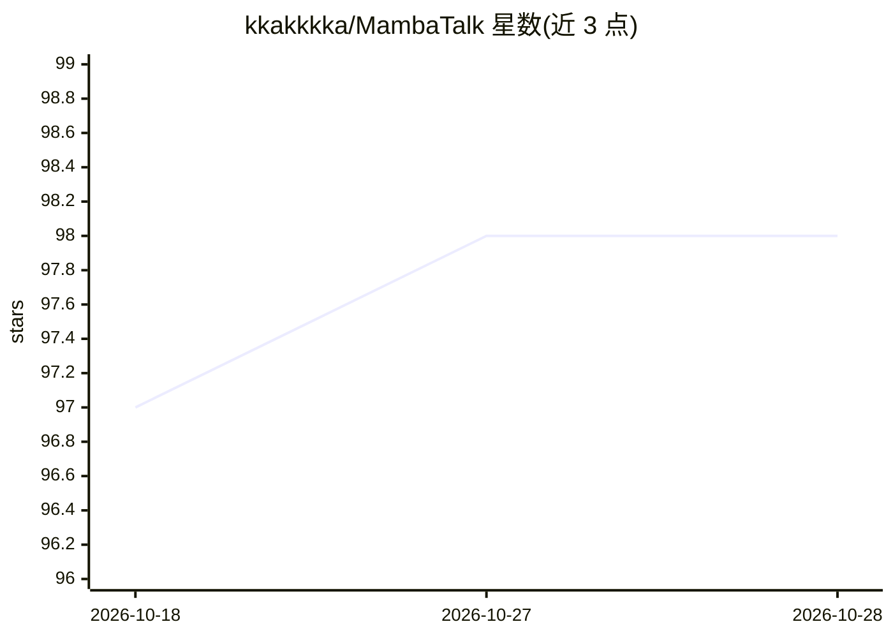

# kkakkkka/MambaTalk

⭐ 98 · Python · Apache-2.0 · 推送 2026-10-10 · [GitHub](https://github.com/kkakkkka/MambaTalk) · 组织维护

**语音驱动全身手势与面部动作合成的 PyTorch 研究代码（NeurIPS 2024）**

MambaTalk 论文的官方 PyTorch 实现，基于选择性状态空间模型（Mamba）从语音生成包含面部、身体在内的整体手势动作序列。提供推理代码、预训练权重（Hugging Face 下载）、训练脚本与 VQ-VAE 组件训练入口；数据准备使用 BEAT2 数据集，自定义数据需配合 Montreal Forced Aligner 生成 TextGrid 对齐文件，并用渲染脚本可视化生成的 .npz 动作。推荐环境为 Python 3.9.21 与 CUDA 12.2，面向动作生成与虚拟人方向的研究者。

## 筛选速览

| 维度 | 判定 | 备注 |
|---|---|---|
| AI 角色 | `ai-native` | 本体是模型或模型工具 |
| 许可风险 | `permissive` | Apache-2.0 |
| 部署形态 | `library` | 以包/库形式分发 |
| 模型依赖 | — | README 未给出锁定关系 |
| 硬件要求 | — | 无带数字的原话,不猜 |
| 安装摩擦 | `medium` | 含编译或系统依赖之一 |
| 成熟度 | — | 结构信号不足 |

## 能力要点

- 选择性状态空间模型（Mamba）驱动的整体手势合成
- 提供预训练权重与训练/评测脚本
- 支持 BEAT2 数据集与自定义数据流程（MFA 对齐）
- 含 VQ-VAE 组件（面部等）的训练命令

## 适用场景

- 复现论文的手势合成训练与评测
- 基于 BEAT2 或自定义语音数据生成说话人整体动作
- 在 Mamba 架构基础上开展动作生成研究

## 场景标签

 · 领域:计算机视觉/动作生成

## 证据(README 行号)

> L3: > **Official PyTorch implementation of MambaTalk: Efficient Holistic Gesture Synthesis with Selective State Space Mo
> L5: MambaTalk leverages the power of Selective State Space Models to achieve efficient and high-quality holistic gesture

## 星数曲线

2026-10-18 97 → 2026-10-28 98（+1）

---
*卡片 v1 · prompt 1.4 · 生成 2026-10-23 · 置信度 mid · 依据 README sha `6499b5a12c56` · [字段定义](../../DATASET.md)*
