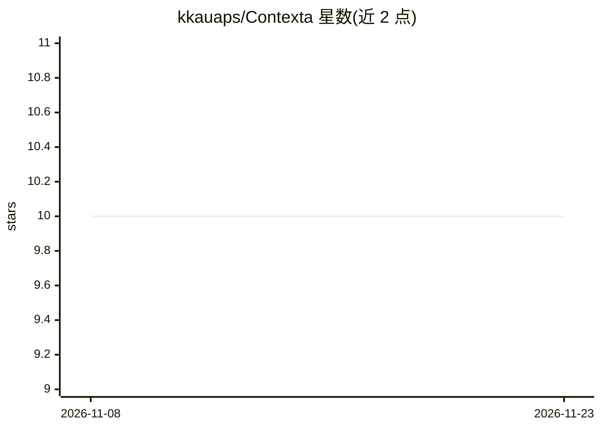

# kkauaps/Contexta

⭐ 10 · Python · NOASSERTION · 推送 2026-11-14 · [GitHub](https://github.com/kkauaps/Contexta) · 个人维护

**为 AI 编码助手生成符合 token 预算的代码库上下文包**

Contexta 读取代码库，按任务对文件排序、控制在用户设定的 token 预算内，并在导出前替换疑似密钥。提供 MCP 服务器（供 Claude Code、Cursor、Windsurf 调用）、GitHub Action、CLI 与桌面 GUI 四种使用方式。内部维护 SQLite 项目图（文件、符号、测试、调用关系），支持按 bugfix/review/onboarding/refactor 等预设生成 Markdown 或 JSON 输出。默认开启密钥脱敏，凭据文件拒绝读取；基准测试中自述在预算控制上与 Repomix、Gitingest 对比，并坦述原始速度较慢的短板。

## 筛选速览

| 维度 | 判定 | 备注 |
|---|---|---|
| AI 角色 | `ai-ecosystem` | LLM/agent 周边工具 |
| 许可风险 | `none` | NOASSERTION |
| 部署形态 | `desktop` | 安装包/桌面程序 |
| 模型依赖 | locked-api |  |
| 硬件要求 | — | 无带数字的原话,不猜 |
| 安装摩擦 | `low` | 无编译、无系统依赖或容器化 |
| 成熟度 | — | 结构信号不足 |

## 能力要点

- MCP 服务器提供 13 个工具（scan_project、context_for、impacted_tests、graph_query 等），仅读取 --root 范围内文件
- token 预算控制：按分数保留文件、必要时收紧压缩级别，并列出被舍弃内容
- 默认密钥脱敏，.env/私钥等凭据文件完全不读取，支持 --dry-run 预览
- 本地 SQLite 项目图支持增量更新与影响分析（谁调用此函数、哪些测试需运行）

## 适用场景

- 向 Claude Code 或 Cursor 提供 bug 修复所需的精准代码上下文
- 代码评审时生成针对 main 分支 diff 的上下文包
- 新人入职或 AI 交接时生成项目导览
- 在 token 预算内导出不含密钥的仓库上下文

## 场景标签

`代码审查` `编码 Agent` · 领域:编码与开发

## 证据(README 行号)

> L7: Contexta reads a codebase, keeps the files that matter for the task, fits them into the token budget you set, and st
> L48: |**MCP Server**|`contexta serve --root ~/code`|Tool server for Claude Code, Cursor and Windsurf. Reads only inside 
> L55: The MCP server is the primary way to use Contexta. AI coding assistants call it as a tool to understand your projec

## 星数曲线

2026-11-08 10 → 2026-11-23 10（+0）

---
*卡片 v1 · prompt 1.4 · 生成 2026-11-19 · 置信度 high · 依据 README sha `9cd8e7b3c202` · [字段定义](../../DATASET.md)*
