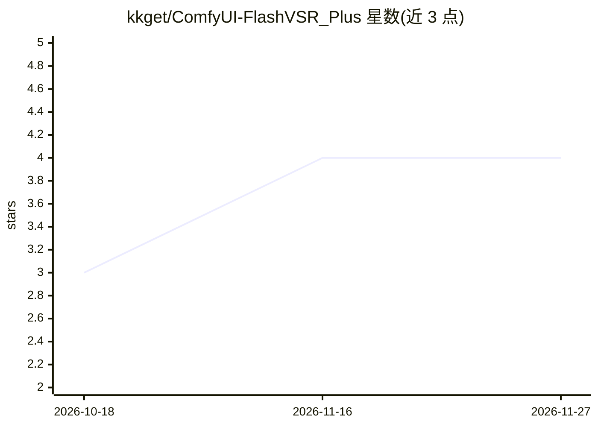

# kkget/ComfyUI-FlashVSR_Plus

⭐ 4 · Python · Apache-2.0 · 推送 2026-10-16 · [GitHub](https://github.com/kkget/ComfyUI-FlashVSR_Plus) · 个人维护 · 中文 README

**为 ComfyUI 提供官方 FlashVSR+ 视频超分模型的节点插件**

社区适配插件，将官方 FlashVSR+ 代码与权重接入 ComfyUI，提供 Turbo/Base/V1 三种模型模式与可跨任务复用的 PIPE。支持 IMAGE 批次与原生 VIDEO 输入、流式 VIDEO 输出避免完整帧占满 RAM、可选音频透传。内置按显卡总/空闲显存自动选择 official/balanced/low_vram 推理策略的机制，配合空间 tiling、权重 offload 与 OOM 重试降低显存占用。模型权重通过 Hugging Face 自动或手动下载。README 强调默认 1× 倍率、从短视频低内存起步，并给出各倍率下的内存估算表。

## 筛选速览

| 维度 | 判定 | 备注 |
|---|---|---|
| AI 角色 | `ai-native` | 本体是模型或模型工具 |
| 许可风险 | `permissive` | Apache-2.0 |
| 部署形态 | `desktop` | 安装包/桌面程序 |
| 模型依赖 | — | README 未给出锁定关系 |
| 硬件要求 | `gpu-24g` | |
| 安装摩擦 | `medium` | 含编译或系统依赖之一 |
| 成熟度 | — | 结构信号不足 |

## 能力要点

- 自动显存策略：检测 CUDA 总/空闲显存选择 official/balanced/low_vram
- 支持 IMAGE 与原生 VIDEO 输入及流式 VIDEO 输出与音频透传
- tiling、权重 offload、OOM 重试等低显存推理机制
- 注意力后端自动优先级 BSA → Triton → SDPA

## 适用场景

- 在 ComfyUI 工作流中对短视频做超分放大
- 显存有限的显卡上通过分块与卸载运行超分推理
- 长视频用流式节点避免完整 IMAGE 输出占满内存

## 场景标签

`图像视频处理` · 领域:感知与多模态

## 证据(README 行号)

> L3: 官方 FlashVSR+ 的 ComfyUI 节点：Turbo / Base / V1、可复用 PIPE、IMAGE / 原生 VIDEO 输入、自动显存策略、完整时序处理和可选音频透传。
> L5: 社区适配插件，使用官方代码与权重；并非 OpenImagingLab 官方发布的 ComfyUI 扩展。模型权重单独下载。
> L86: 需要 NVIDIA CUDA 显卡和 BF16 支持。官方参考平台为 Linux / Python 3.10 / PyTorch 2.5–2.7。此插件保留 ComfyUI 自己的 PyTorch，不自动安装/降级 Torch。W

## 星数曲线

2026-10-18 3 → 2026-11-27 4（+1）

---
*卡片 v1 · prompt 1.4 · 生成 2026-11-26 · 置信度 high · 依据 README sha `74c7e67c9c0a` · [字段定义](../../DATASET.md)*
