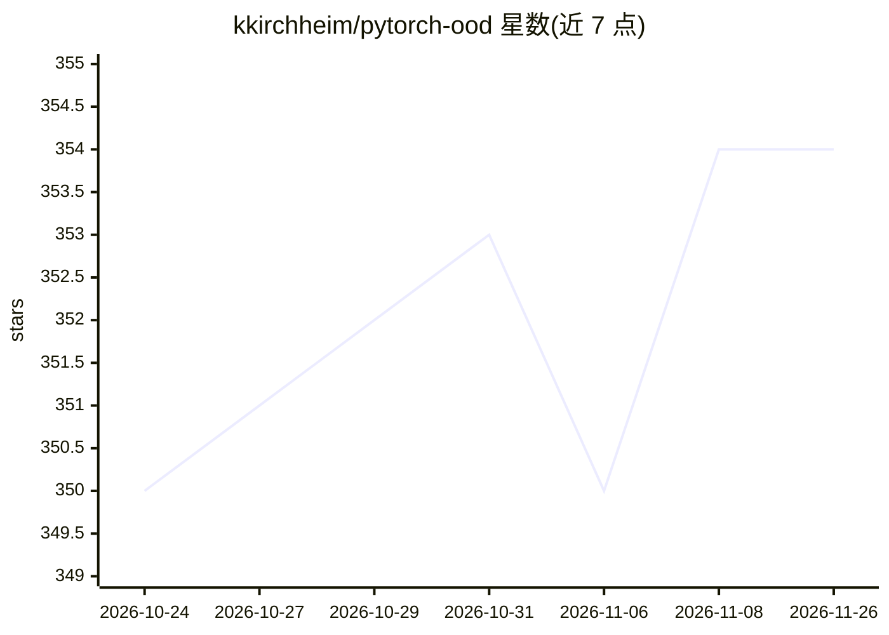

# kkirchheim/pytorch-ood

⭐ 354 · Python · Apache-2.0 · 推送 2026-11-23 · [GitHub](https://github.com/kkirchheim/pytorch-ood) · [官网](https://pytorch-ood.readthedocs.io/) · 个人维护

**为深度学习研究者提供 PyTorch 实现的分布外检测方法库**

基于 PyTorch 的分布外（OOD）检测 Python 库，提供多种检测器实现（如 OpenMax、Mahalanobis、Energy-Based、ODIN、ReAct 等）、损失函数、数据集、网络架构与预训练权重、数据增强及工具函数，并覆盖开放集识别、新颖性检测、置信度估计与异常检测等相关领域方法。设计为可与 pytorch-lightning、pytorch-segmentation-models 框架配合使用，统一约定检测器输出离群分数。通过 PyPI 安装，依赖 torch/torchvision/scipy，附 JOSS 与 CVPRW 论文引用及在线文档。

## 筛选速览

| 维度 | 判定 | 备注 |
|---|---|---|
| AI 角色 | `ai-native` | 本体是模型或模型工具 |
| 许可风险 | `permissive` | Apache-2.0 |
| 部署形态 | `library` | 以包/库形式分发 |
| 模型依赖 | — | README 未给出锁定关系 |
| 硬件要求 | — | 无带数字的原话,不猜 |
| 安装摩擦 | `medium` | 含编译或系统依赖之一 |
| 成熟度 | — | 结构信号不足 |

## 能力要点

- 内置 OpenMax、Mahalanobis、Energy-Based、ODIN、ReAct 等多种 OOD 检测器实现
- 提供损失函数、数据集、预训练模型权重与数据增强
- 提供 OpenOOD v1.5 CIFAR 基准评测接口，支持 logits/特征缓存复用
- 设计为兼容 pytorch-lightning 与 pytorch-segmentation-models

## 适用场景

- 在图像分类模型上评估输入是否超出训练分布
- 复现论文中的 OOD 检测方法与基准实验
- 为开放集识别任务选择和比较不同检测器

## 场景标签

`模型评测` · 领域:评测与运维

## 证据(README 行号)

> L41: A Python library for Out-of-Distribution (OOD) Detection with Deep Neural Networks based on PyTorch.
> L45: - Out-of-Distribution Detection Methods

## 星数曲线

2026-10-24 350 → 2026-11-26 354（+4）

---
*卡片 v1 · prompt 1.4 · 生成 2026-11-25 · 置信度 high · 依据 README sha `ad57fb2f414b` · [字段定义](../../DATASET.md)*
