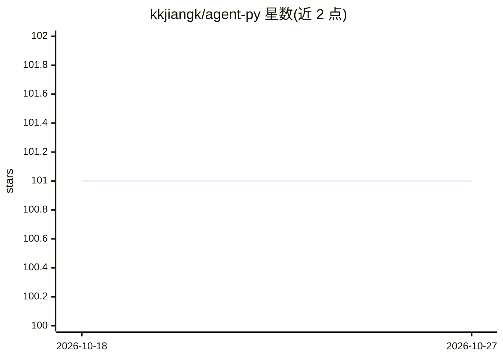

# kkjiangk/agent-py

⭐ 101 · Python · 推送 2026-10-04 · [GitHub](https://github.com/kkjiangk/agent-py) · 个人维护 · 中文 README

**个人 AIOps 工程：用 agent 诊断告警并生成带证据的处置报告**

个人工程实践项目，围绕告警调查构建：后端基于 FastAPI/LangGraph，编排 Plan-Execute-Replan 工作流读取 Prometheus/Alertmanager 活跃告警，调用配置的 MCP 工具与模型服务生成证据链报告，并支持处置提案的审批与派发（SQLite 单事务、commandId 去重）。检索侧支持 Markdown/PDF 摄入、Milvus 向量召回与 BM25L 词法召回的倒数排序融合与重排。事件交付使用 Kafka 手动提交偏移与 Redis 租约。限定本地单节点场景，UI 为中文。

## 筛选速览

| 维度 | 判定 | 备注 |
|---|---|---|
| AI 角色 | `ai-native` | 本体是模型或模型工具 |
| 许可风险 | `none` | — |
| 部署形态 | `self-host` | docker 或自建部署 |
| 模型依赖 | — | README 未给出锁定关系 |
| 硬件要求 | — | 无带数字的原话,不猜 |
| 安装摩擦 | `low` | 无编译、无系统依赖或容器化 |
| 成熟度 | — | 结构信号不足 |

## 能力要点

- LangGraph Plan-Execute-Replan 告警诊断工作流与证据链报告
- Milvus 向量 + BM25L 词法混合检索与可溯源引用
- Kafka 手动提交偏移、Redis 租约与死信处理的事件交付
- API/worker 版本核查与回滚工具、Playwright 浏览器测试

## 适用场景

- 调查 Prometheus/Alertmanager 告警并生成带证据的诊断报告
- 检索运维 runbook 并获得可溯源引用的回答
- 审批并可靠派发处置命令（至少一次投递，下游按 commandId 去重）

## 场景标签

`RAG` · 领域:知识与检索

## 证据(README 行号)

> L5: A personal engineering project for investigating alerts with tool-backed evidence, retrieving runbooks, and reviewin
> L14: - **Incident diagnosis:** a LangGraph Plan-Execute-Replan workflow, active Prometheus/Alertmanager alerts, evidence
> L32: Requirements: **Python 3.10+**, **uv**, **Node.js 22+**, **Docker Compose**, access to the configured Qwen-compatib

## 星数曲线

2026-10-18 101 → 2026-10-27 101（+0）

---
*卡片 v1 · prompt 1.4 · 生成 2026-10-24 · 置信度 high · 依据 README sha `e556066dfb49` · [字段定义](../../DATASET.md)*
