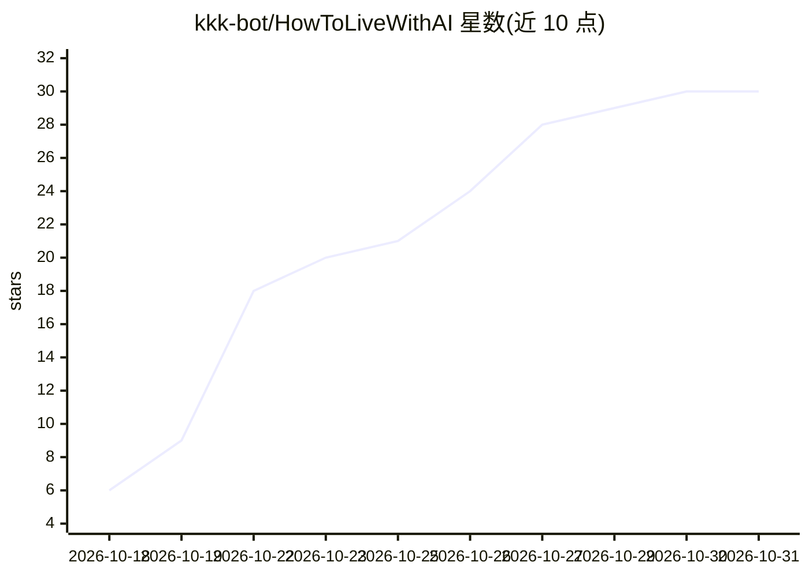

# kkk-bot/HowToLiveWithAI

⭐ 30 · HTML · NOASSERTION · 推送 2026-10-20 · [GitHub](https://github.com/kkk-bot/HowToLiveWithAI) · [官网](https://kkk-bot.github.io/HowToLiveWithAI/) · 个人维护 · 中文 README

**写给普通年轻人的中文 AI 学习指南（6 章 29 节）**

一份面向普通年轻人的 AI 学习参考指南：用白话讲解 AI 基础概念（模型、记忆、幻觉）、与 AI 配合的方法、技能选择、行动安排、工作机会与使用边界，共 6 章 29 节正文加 4 个附录，配练习与参考答案。依据分级标注为研究、官方资料与作者建议，作者方法尚未经读者实测；提供 HTML/PDF/离线包阅读形式，附研究资料索引（R01—R41）。仓库含 book/ 源文件与 Python/Node 构建脚本，内容以 CC BY 4.0 发布，另有 PDF 付费下载版。

## 筛选速览

| 维度 | 判定 | 备注 |
|---|---|---|
| AI 角色 | `ai-knowledge` | 知识聚合/清单类 |
| 许可风险 | `none` | NOASSERTION |
| 部署形态 | `library` | 以包/库形式分发 |
| 模型依赖 | — | README 未给出锁定关系 |
| 硬件要求 | — | 无带数字的原话,不猜 |
| 安装摩擦 | `low` | 无编译、无系统依赖或容器化 |
| 成熟度 | `idea` | |

## 能力要点

- 6 章 29 节正文 + 4 个附录，v0.19.1，附练习与参考答案
- 依据分级（研究/官方资料/作者建议）并明示使用边界与未实测声明
- 提供 HTML 检索、连续阅读、PDF（67 个书签）与离线阅读包
- 仓库含生成脚本，同步 HTML/Markdown/PDF 并校验编号与交叉引用

## 适用场景

- 刚接触 AI，想了解基础概念再决定学什么
- 想通过可检查的小练习开始使用 AI
- 按眼前问题（求职、办公、家庭使用）选读相关章节

## 场景标签

`教程课程` · 领域:学习与行业

## 证据(README 行号)

> L9: **这是一份写给正在学习、初入职场或寻找方向的普通年轻人的 AI 学习指南。用白话认识基础知识，讨论值得学的技能，再从一件容易检查的小事开始。**
> L11: 认识 AI，减少焦虑，学会判断，从小事开始行动。你可以按六章主线阅读，也可以从眼前的问题选读；无需购买昂贵工具、完成商业项目或公开作品。每节说明理由、做法、可尝试的动作和检查方法。正文补有工具选择、资料冲突、数据比例、学习纠错、岗

## 星数曲线

2026-10-18 6 → 2026-10-31 30（+24）

---
*卡片 v1 · prompt 1.4 · 生成 2026-10-27 · 置信度 high · 依据 README sha `8de7e36c9d10` · [字段定义](../../DATASET.md)*
