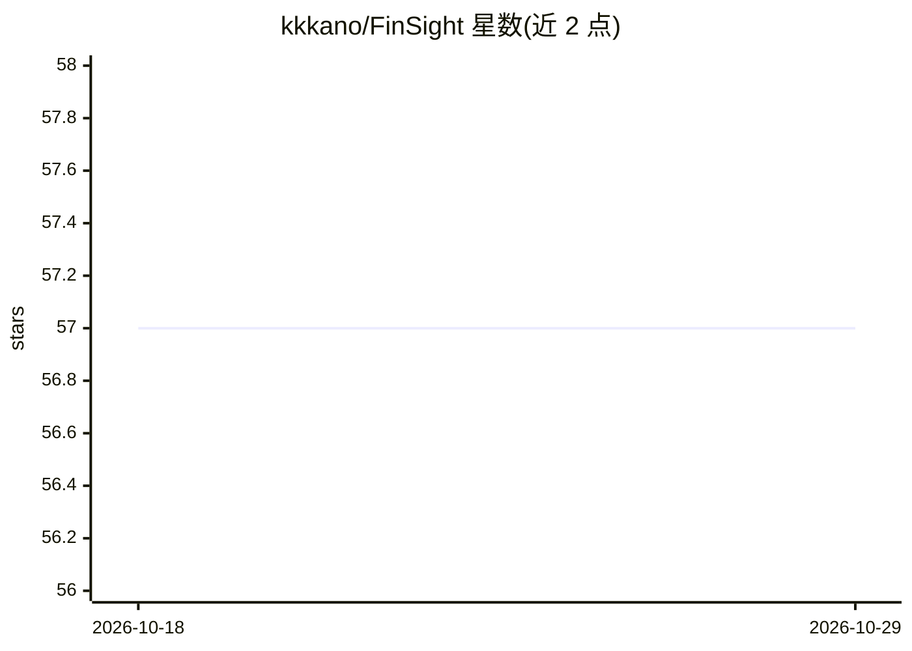

# kkkano/FinSight

⭐ 57 · Python · MIT · 推送 2026-10-09 · [GitHub](https://github.com/kkkano/FinSight) · 个人维护 · 中文 README

**面向投资者的多智能体会话式金融研究平台**

基于 LangGraph 构建的多智能体金融研究系统，面向金融研究人员与个人投资者：7 个专业智能体（价格/新闻/基本面/技术面/宏观/风险/深度搜索）并行执行，经意图路由与证据优先合成后流式返回；提供 6 标签专业仪表盘、混合 RAG（bge-m3 + bge-reranker-v2-m3）、自动生成 8 章节研究报告、投资组合监控、自主任务执行（Workbench）与邮件主动告警。LLM 端点可配置（OpenAI/Gemini/DeepSeek/Anthropic），需 API key；以 Docker Compose 或源码方式部署。

## 筛选速览

| 维度 | 判定 | 备注 |
|---|---|---|
| AI 角色 | `ai-native` | 本体是模型或模型工具 |
| 许可风险 | `permissive` | MIT |
| 部署形态 | `self-host` | docker 或自建部署 |
| 模型依赖 | — | README 未给出锁定关系 |
| 硬件要求 | — | 无带数字的原话,不猜 |
| 安装摩擦 | `low` | 无编译、无系统依赖或容器化 |
| 成熟度 | — | 结构信号不足 |

## 能力要点

- 7 个专业金融智能体并行执行与证据优先合成管线
- 混合 RAG：bge-m3 稠密+稀疏检索，bge-reranker-v2-m3 重排，3 层评测
- 自动生成 8 章节投资报告与投资组合再平衡（LLM 增强）
- LLM token/成本计量、幻觉防御与 11 源价格级联回退

## 适用场景

- 会话式获取股票价格、新闻、基本面与技术面综合研究
- 让平台自动执行研究任务并生成投资报告
- 监控投资组合并接收价格/新闻/风险邮件告警

## 场景标签

`金融量化` `多智能体` · 领域:Agent 开发

## 证据(README 行号)

> L13: **FinSight AI** is a production-grade, multi-agent financial research system built on **LangGraph**. It unifies con
> L21: |**Multi-Agent Research**|7 specialized agents (Price, News, Fundamental, Technical, Macro, Risk, DeepSearch) runni
> L25: |**Hybrid RAG**|bge-m3 (1024-dim Dense + Sparse) with bge-reranker-v2-m3 cross-encoder; 3-layer eval gate (12/12 PA

## 星数曲线

2026-10-18 57 → 2026-10-29 57（+0）

---
*卡片 v1 · prompt 1.4 · 生成 2026-10-24 · 置信度 mid · 依据 README sha `1ccd1cfd82e7` · [字段定义](../../DATASET.md)*
