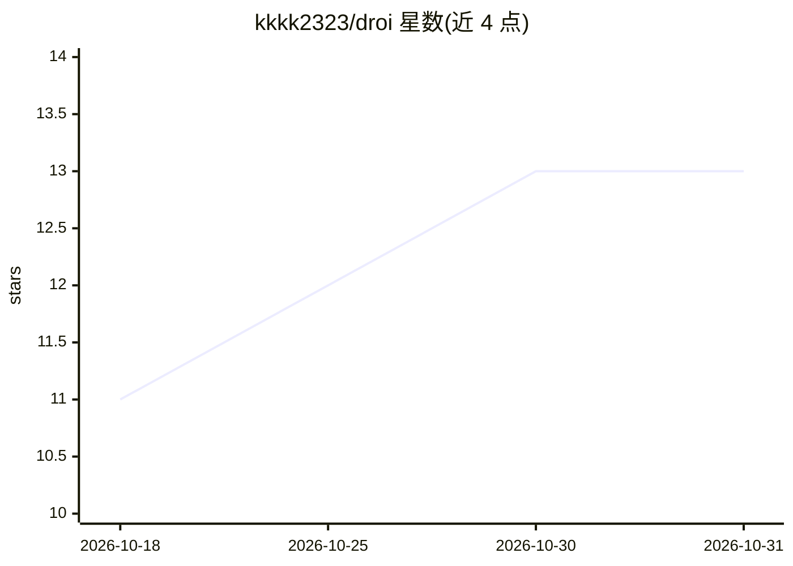

# kkkk2323/droi

⭐ 13 · Go · MIT · 推送 2026-10-30 · [GitHub](https://github.com/kkkk2323/droi) · [官网](https://github.com/kkkk2323/droi/releases/latest) · 个人维护

**Factory Droid 编码代理的 Mac/Windows/iPhone 原生客户端**

面向 Factory Droid CLI 用户的原生桌面与手机客户端：通过 droid-sdk-go 连接 droid daemon，在统一窗口中展示并驱动与 CLI 相同的 Sessions（转录、流式回复、工具调用、Prompts、Skills、MCP Servers）。Mac/Windows 提供安装包，iPhone 端经 Xcode 构建后通过 Gateway 配对远程访问；自带 Memory 会话摘要、多账号、自动更新与本地代理支持。本体不含代理逻辑，所有工作由 Droid 完成。

## 筛选速览

| 维度 | 判定 | 备注 |
|---|---|---|
| AI 角色 | `ai-ecosystem` | LLM/agent 周边工具 |
| 许可风险 | `permissive` | MIT |
| 部署形态 | `desktop` | 安装包/桌面程序 |
| 模型依赖 | — | README 未给出锁定关系 |
| 硬件要求 | — | 无带数字的原话,不猜 |
| 安装摩擦 | `low` | 无编译、无系统依赖或容器化 |
| 成熟度 | — | 结构信号不足 |

## 能力要点

- 与 droid CLI 共享登录与同一批 Sessions，桌面与手机可接力同一 Session
- iPhone 经 Gateway 配对访问，Factory 凭据不离开 Mac
- 按 Session 设置模型、推理力度、自主度与工具模式，可接入 Magpie 网关模型
- Memory 机制：会话结束自动摘要，新会话以摘要开场

## 适用场景

- 在统一窗口中管理所有 Droid 编码代理会话，包括 CLI 启动的会话
- 离开电脑后用 iPhone 继续操作并批准工具调用
- 查看流式回复、推理过程与工具调用结果并排队下一条消息

## 场景标签

`编码 Agent` · 领域:编码与开发

## 证据(README 行号)

> L13: Droi is a Client of `droid daemon`, the Daemon in the Droid CLI. It shows and drives the same Sessions as the CLI, 
> L84: Droi adds no agent of its own. All the work is done by Droid; Droi gives it a window.
> L86: - **The Daemon**: Droi starts `droid daemon` from the Droid CLI and talks to it over the Daemon's own protocol thro

## 星数曲线

2026-10-18 11 → 2026-10-31 13（+2）

---
*卡片 v1 · prompt 1.4 · 生成 2026-10-31 · 置信度 mid · 依据 README sha `6aa6cfbcdd57` · [字段定义](../../DATASET.md)*
