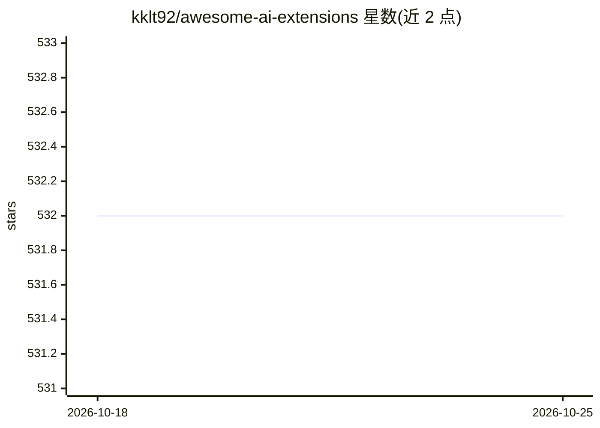

# kklt92/awesome-ai-extensions

⭐ 532 · CC0-1.0 · 推送 2026-04-08 · [GitHub](https://github.com/kklt92/awesome-ai-extensions) · 个人维护

**AI 浏览器扩展/插件策展清单，按用途分类收录**

一个 awesome 风格的策展清单，收录 AI 驱动的浏览器扩展、插件与附加组件。条目按 9 个类别组织：浏览器 Agent、自动化工作流、写作编辑、研究摘要、搜索增强、编码开发、生产力会议、翻译、邮件沟通、阅读与无障碍。每条为名称加一句话功能描述，涵盖 Claude、HARPA AI、Grammarly、Immersive Translate、Otter.ai 等，未收录的条目不涉及安装方法或源码。

## 筛选速览

| 维度 | 判定 | 备注 |
|---|---|---|
| AI 角色 | `ai-knowledge` | 知识聚合/清单类 |
| 许可风险 | `viral` | CC0-1.0 |
| 部署形态 | `None` |  |
| 模型依赖 | — | README 未给出锁定关系 |
| 硬件要求 | — | 无带数字的原话,不猜 |
| 安装摩擦 | `low` | 无编译、无系统依赖或容器化 |
| 成熟度 | — | 结构信号不足 |

## 能力要点

- 按 9 个用途类别组织的浏览器 AI 扩展清单
- 覆盖浏览器 Agent、自动化、写作、研究、翻译、会议转录等场景
- 每条目附一句话功能描述

## 适用场景

- 按用途查找写作、翻译、摘要类 AI 浏览器扩展
- 了解浏览器 AI 工具生态的覆盖范围
- 为自动化或研究工作流挑选合适扩展

## 场景标签

`精选清单` · 领域:学习与行业

## 证据(README 行号)

> L3: > A curated list of AI-powered browser extensions, plugins, and add-ons.
> L5: Browser extensions that use artificial intelligence to help you write, research, automate, translate, code, and brow

## 星数曲线

2026-10-18 532 → 2026-10-25 532（+0）

---
*卡片 v1 · prompt 1.4 · 生成 2026-10-21 · 置信度 high · 依据 README sha `f7e7ef01d6ad` · [字段定义](../../DATASET.md)*
