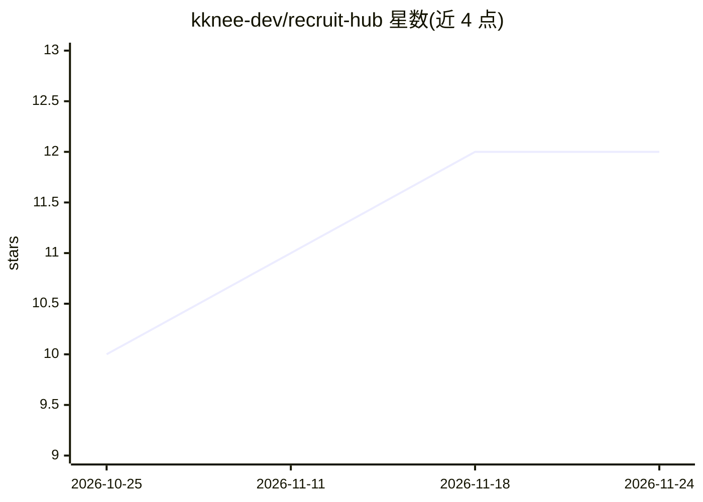

# kknee-dev/recruit-hub

⭐ 12 · JavaScript · MIT · 推送 2026-11-22 · [GitHub](https://github.com/kknee-dev/recruit-hub) · [官网](https://xiaozhaobao.com.cn) · 个人维护 · 中文 README

**给应届生与 AI 助手的中国校招信息聚合站（MCP 只读检索）**

零依赖的校园招聘信息聚合站：git clone 后用 Node 22 原生 node:sqlite 直接运行，无需 npm install 与数据库服务。功能含岗位筛选、企业档案、求职攻略、岗位练习与薪资参考，并随仓库发布脱敏公开招聘数据集（CSV/JSON）与自动生成的校招情报周报。内置只读 MCP Server，供 Claude、Cursor、Gemini CLI 等客户端检索岗位；含管理后台 CSV 导入与 fingerprint 去重的数据管道，环境变量全部可选，AI 功能需自配 DeepSeek 密钥否则降级。

## 筛选速览

| 维度 | 判定 | 备注 |
|---|---|---|
| AI 角色 | `ai-enhanced` | 去掉 AI 部分产品仍成立 |
| 许可风险 | `permissive` | MIT |
| 部署形态 | `library` | 以包/库形式分发 |
| 模型依赖 | — | README 未给出锁定关系 |
| 硬件要求 | — | 无带数字的原话,不猜 |
| 安装摩擦 | `low` | 无编译、无系统依赖或容器化 |
| 成熟度 | — | 结构信号不足 |

## 能力要点

- 零依赖：Node 22 原生 node:sqlite，git clone 即跑
- 内置只读 MCP Server，提供 5 个岗位检索工具，免 API Key
- 随仓库发布脱敏公开招聘数据集与校招情报周报
- 支持管理后台 CSV 批量导入与 fingerprint 自动去重

## 适用场景

- 检索全国在招校招岗位、查看企业与薪资信息
- 通过 Cursor/Claude 等 AI 助手直接查询校招数据
- 用公开脱敏数据集做检索研究、可视化或训练样本
- 学生社团/就业办接入自有岗位数据建站

## 场景标签

 · 领域:求职招聘/信息聚合

## 证据(README 行号)

> L8: **零依赖的校园招聘信息聚合站** —— `git clone` 一条命令即可跑起来，无需 npm install、无需构建、无需数据库服务。
> L83: ## 🤖 接入 AI 助手（MCP）—— 让 AI 直接回答中国校招问题
> L87: 校招宝提供 **MCP Server**（免 API Key · 免注册 · 只读），Claude、ChatGPT、Cursor、腾讯 WorkBuddy、Gemini CLI 等 AI 助手可直接检索全国在招校招岗位。

## 星数曲线

2026-10-25 10 → 2026-11-24 12（+2）

---
*卡片 v1 · prompt 1.4 · 生成 2026-11-18 · 置信度 mid · 依据 README sha `f43d29e82442` · [字段定义](../../DATASET.md)*
