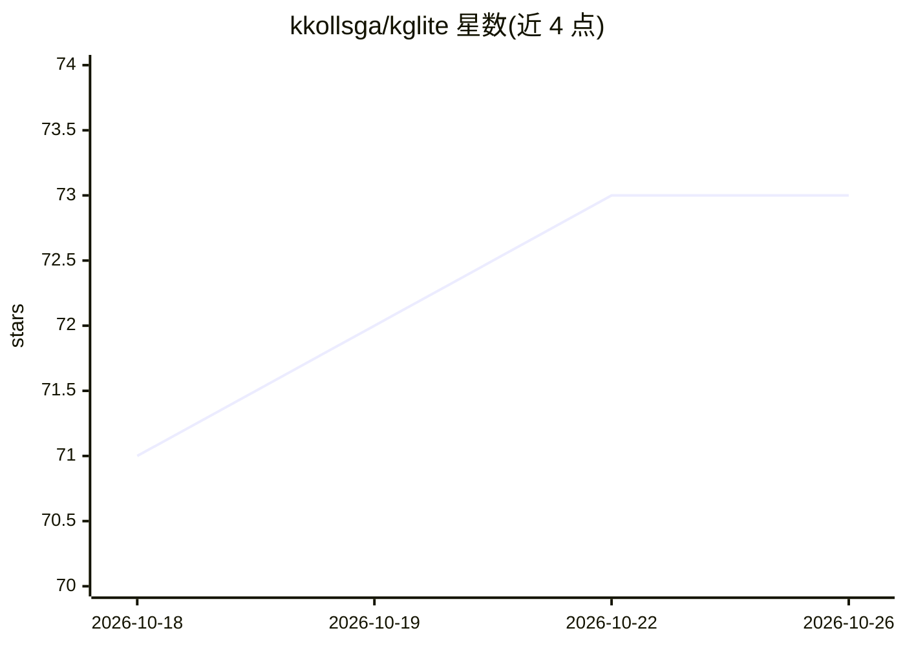

# kkollsga/kglite

⭐ 73 · Rust · MIT · 推送 2026-10-24 · [GitHub](https://github.com/kkollsga/kglite) · 个人维护

**面向 LLM agent 的嵌入式 Cypher 知识图谱引擎（Python/Rust）**

纯 Rust 实现的嵌入式知识图谱引擎，以 Cypher 查询，无需外部数据库服务，Python wheel 无必需运行时依赖。同一 .kgl 图文件可服务于应用、分析师或 LLM agent。内置 MCP server（kglite-mcp-server）向 Claude Desktop、Cursor 等 MCP 客户端暴露 cypher_query、schema 内省等工具；describe() 按图规模分四档输出适配提示词的 schema；支持 valid-time 历史查询、本体校验、向量/BM25 混合检索。同一引擎提供 Python、Rust、Java、C ABI、CLI、Node.js、Bolt server 七种接入方式，磁盘存储可查询超出内存的图（如 16 GB 笔记本上 1.24 亿节点 Wikidata）。

## 筛选速览

| 维度 | 判定 | 备注 |
|---|---|---|
| AI 角色 | `ai-ecosystem` | LLM/agent 周边工具 |
| 许可风险 | `permissive` | MIT |
| 部署形态 | `library` | 以包/库形式分发 |
| 模型依赖 | — | README 未给出锁定关系 |
| 硬件要求 | — | 无带数字的原话,不猜 |
| 安装摩擦 | `low` | 无编译、无系统依赖或容器化 |
| 成熟度 | — | 结构信号不足 |

## 能力要点

- 嵌入式 Cypher 图引擎，进程内运行，无外部数据库服务
- 内置 MCP server，向 MCP 客户端提供查询工具与技能指导
- describe() 四档渐进式 schema，面向 LLM 上下文窗口
- 七种语言/接口接入同一引擎与同一 .kgl 文件

## 适用场景

- 把法律判例、监管规则等领域数据做成 agent 可查询的图
- 在单个 Cypher 查询中做向量相似度 + 图遍历的混合检索
- 多 agent 以一份共享 .kgl 图作为协作契约
- 解析代码库为函数/类/模块节点做代码分析

## 场景标签

`知识图谱` `Agent 记忆` · 领域:Agent 开发

## 证据(README 行号)

> L10: KGLite is an embedded, Cypher-queryable knowledge graph for Python and Rust.
> L108: ### One command turns any current `.kgl` into an MCP server
> L111: kglite-mcp-server --graph path/to/graph.kgl

## 星数曲线

2026-10-18 71 → 2026-10-26 73（+2）

---
*卡片 v1 · prompt 1.4 · 生成 2026-10-24 · 置信度 high · 依据 README sha `95f719452b61` · [字段定义](../../DATASET.md)*
