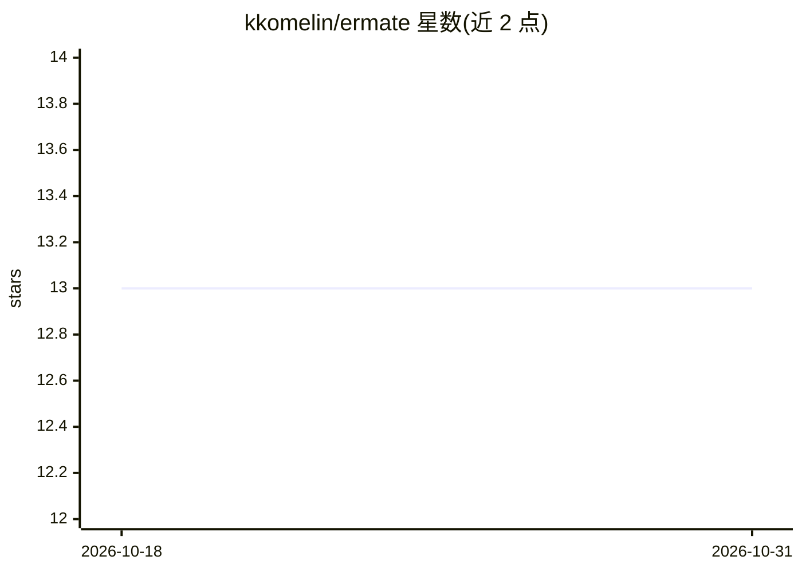

# kkomelin/ermate

⭐ 13 · TypeScript · Apache-2.0 · 推送 2026-10-11 · [GitHub](https://github.com/kkomelin/ermate) · [官网](https://ermate.app) · 个人维护

**AI 辅助的可视化数据库 ER 图设计器（PWA）**

基于 React 19 + React Flow 的浏览器端 ER 图设计工具：在可交互画布上拖拽创建表、列与约束，可视化定义一对一/一对多/多对多关系并自动生成联结表；支持通过自然语言提示创建表、列与关系（Hono + AI SDK 实现 AI API，需自备 API key）。可导出/导入 SQL DDL（PostgreSQL/MySQL/SQLite 方言）与 JSON，通过 URL 压缩链接分享 schema。无后端数据库，所有数据存于浏览器 localStorage；以 PWA 形式提供离线安装。面向需要设计数据库 schema 的开发者。

## 筛选速览

| 维度 | 判定 | 备注 |
|---|---|---|
| AI 角色 | `ai-enhanced` | 去掉 AI 部分产品仍成立 |
| 许可风险 | `permissive` | Apache-2.0 |
| 部署形态 | `library` | 以包/库形式分发 |
| 模型依赖 | — | README 未给出锁定关系 |
| 硬件要求 | — | 无带数字的原话,不猜 |
| 安装摩擦 | `low` | 无编译、无系统依赖或容器化 |
| 成熟度 | — | 结构信号不足 |

## 能力要点

- 自然语言提示创建表、列与关系，含批量操作与自动布局
- SQL DDL 导出/导入，支持 PostgreSQL/MySQL/SQLite 方言
- schema 编码进 URL hash 的压缩分享链接
- PWA 可安装并支持离线，数据全部存于浏览器 localStorage

## 适用场景

- 设计数据库表结构与关系并生成 SQL DDL
- 用自然语言快速生成初始 schema 再手动调整
- 通过链接把 schema 设计分享给他人查看

## 场景标签

`代码生成` · 领域:编码与开发

## 证据(README 行号)

> L5: # ERMate - AI-powered Visual Database Schema Designer
> L19: - **AI-powered design** - create tables, columns, and relationships using natural language; includes batch operatio
> L70: The app includes an AI API (Hono + AI SDK) for natural language schema generation, but has no backend database. All

## 星数曲线

2026-10-18 13 → 2026-10-31 13（+0）

---
*卡片 v1 · prompt 1.4 · 生成 2026-10-31 · 置信度 mid · 依据 README sha `036774ab94f0` · [字段定义](../../DATASET.md)*
