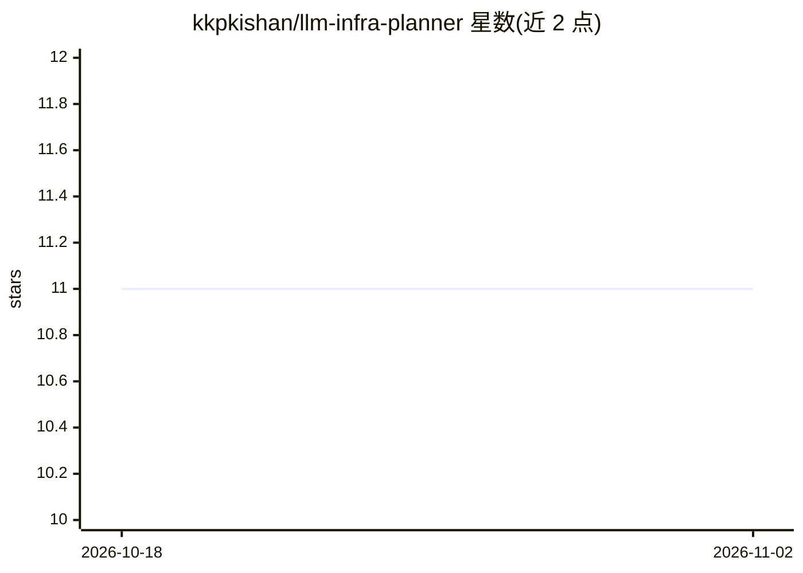

# kkpkishan/llm-infra-planner

⭐ 11 · TypeScript · 推送 2026-04-23 · [GitHub](https://github.com/kkpkishan/llm-infra-planner) · 个人维护

**浏览器端 LLM 硬件/成本估算计算器：VRAM、吞吐与云成本规划**

完全在浏览器端运行的 LLM 基础设施估算工具，面向 ML 工程师与基础设施架构师：按权重、KV cache、激活、梯度和优化器状态分解显存需求，基于 roofline 模型估算 tokens/sec 吞吐，并对 8 家云厂商 37 种实例做成本比较；提供推理/微调/训练/反向四种模式，支持 MoE、GQA、MLA 等架构，内置 513 个模型与 147 个 GPU 的静态 JSON 数据库，计算公式为纯 TypeScript 函数并有 244 项属性测试。无后端、无遥测、无需账号，提供 Docker 与 npm 两种本地运行方式。

## 筛选速览

| 维度 | 判定 | 备注 |
|---|---|---|
| AI 角色 | `ai-ecosystem` | LLM/agent 周边工具 |
| 许可风险 | `none` | — |
| 部署形态 | `self-host` | docker 或自建部署 |
| 模型依赖 | — | README 未给出锁定关系 |
| 硬件要求 | — | 无带数字的原话,不猜 |
| 安装摩擦 | `low` | 无编译、无系统依赖或容器化 |
| 成熟度 | — | 结构信号不足 |

## 能力要点

- 显存按权重/KV cache/激活/梯度/优化器分解，支持 MoE、GQA、MQA、MLA
- 8 家云厂商 37 种实例的成本与每百万 token 成本比较
- 反向模式：给定 GPU 列出全部可装下的模型及所需精度
- TCO、并发用户容量（TTFT/TPOT SLO）、推测解码、并行策略等高级面板

## 适用场景

- 部署前估算某个模型需要多少显存和哪档 GPU
- 比较各家云厂商的推理成本与吞吐
- 做本地自建 vs 云端的 TCO 与盈亏平衡分析

## 场景标签

 · 领域:LLM 基础设施/容量规划

## 证据(README 行号)

> L3: > A precision-first, fully client-side tool for estimating GPU memory, throughput, latency, and cloud costs for any 
> L9: LLMcalc answers the questions you actually have before deploying or training a large language model:
> L20: Everything runs in the browser. No backend, no telemetry, no account required.

## 星数曲线

2026-10-18 11 → 2026-11-02 11（+0）

---
*卡片 v1 · prompt 1.4 · 生成 2026-11-02 · 置信度 high · 依据 README sha `236a4d4eaa4b` · [字段定义](../../DATASET.md)*
