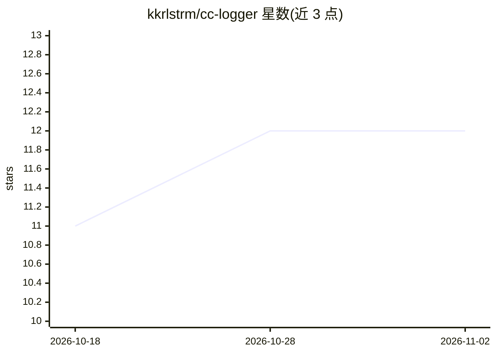

# kkrlstrm/cc-logger

⭐ 12 · Python · AGPL-3.0 · 推送 2026-10-19 · [GitHub](https://github.com/kkrlstrm/cc-logger) · 个人维护

**Claude Code 会话观测工具：把 agent 运行全程记录进 Postgres**

基于 Claude Code HTTP hooks（不修改 Claude Code 本身）的观测层：把每个会话、子 agent 调用、工具调用及工具间叙述文本写入 Postgres 五张表，支持 >50KB 载荷分离存储与可选密钥正则脱敏（默认开启）。模型与 token 用量从 transcript 文件回读补齐。提供 CLI（sessions/inspect/insights/rate）与 17 个即用 SQL 查询，含跨运行工具序列一致性比对以发现流程漂移。面向个人 Claude Code 用户、跨客户/项目复用 agent 的团队与生产 agent 运营者。README 声明本仓库已并入 callusguard，后者为维护包，但本仓库仍在且可用。

## 筛选速览

| 维度 | 判定 | 备注 |
|---|---|---|
| AI 角色 | `ai-ecosystem` | LLM/agent 周边工具 |
| 许可风险 | `viral` | AGPL-3.0 |
| 部署形态 | `self-host` | docker 或自建部署 |
| 模型依赖 | — | README 未给出锁定关系 |
| 硬件要求 | — | 无带数字的原话,不猜 |
| 安装摩擦 | `low` | 无编译、无系统依赖或容器化 |
| 成熟度 | — | 结构信号不足 |

## 能力要点

- HTTP hooks 全量记录会话/子 agent/工具调用与叙述文本
- 17 个 SQL 查询含跨运行工具序列一致性（漂移检测）
- 模型与 token 用量从 transcript 回读，hooks 不提供也能补齐
- 默认密钥脱敏，AGPL-3.0-or-later

## 适用场景

- 回看单个 Claude Code 会话的完整执行树
- 跨多次运行检测同一 agent 的流程漂移
- 对比不同模型版本在同类任务上的真实行为

## 场景标签

`LLM 可观测性` · 领域:评测与运维

## 证据(README 行号)

> L10: **Agent QA infrastructure for Claude Code workflows.** Replay, inspect, and compare agent runs so repeated workflow
> L36: Built on Claude Code's HTTP hooks — no patches or modifications to Claude Code itself.

## 星数曲线

2026-10-18 11 → 2026-11-02 12（+1）

---
*卡片 v1 · prompt 1.4 · 生成 2026-11-01 · 置信度 high · 依据 README sha `cb92b75ac227` · [字段定义](../../DATASET.md)*
