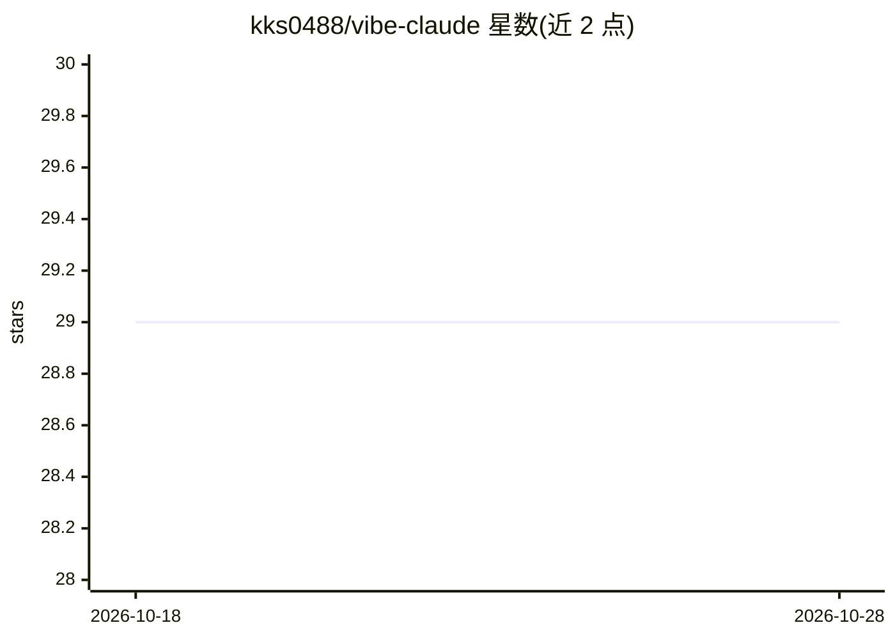

# kks0488/vibe-claude

⭐ 29 · Python · MIT · 推送 2026-10-09 · [GitHub](https://github.com/kks0488/vibe-claude) · [官网](http://aionda.blog) · 个人维护 · 中文 README

**Claude Code 插件：核验 AI 改动真的通过测试，支持备份回滚**

面向不读代码、用 Claude Code 构建项目的用户的 Claude Code 插件。机制：Proof gate 记录每条 shell 命令与退出码，Claude 改完代码未通过测试/构建/运行则被打回；可选安装 OpenAI Codex CLI 作为第二审查者后台复审改动；用项目外的私有 git 仓库做快照，说 undo 即可恢复，删除前有 trash（保留 7 天）；另含危险操作拦截、测试防篡改、包名核验、密钥写入拦截与语法检查。整个插件为单个标准库 Python 文件加一个 skill。需 Claude Code、python3 3.8+ 与 git；Windows 未测试。

## 筛选速览

| 维度 | 判定 | 备注 |
|---|---|---|
| AI 角色 | `ai-ecosystem` | LLM/agent 周边工具 |
| 许可风险 | `permissive` | MIT |
| 部署形态 | `None` |  |
| 模型依赖 | locked-api |  |
| 硬件要求 | — | 无带数字的原话,不猜 |
| 安装摩擦 | `low` | 无编译、无系统依赖或容器化 |
| 成熟度 | — | 结构信号不足 |

## 能力要点

- Proof gate：无测试/构建/运行通过则打回，回复文字与被管道隐藏的结果不算数
- 快照与 undo：项目外私有 git 仓储备份，每项目保留最新 150 份
- 可选 Codex 第二意见：后台只读复审，最多两轮
- 危险操作、测试篡改、可疑包名与密钥写入的拦截检查

## 适用场景

- 让 Claude 改完代码必须真的跑测试才许收工
- 误删文件或改坏后用一句话回滚
- 用另一个 AI 复审 Claude 的改动

## 场景标签

 · 领域:开发者工具/AI 编码辅助

## 证据(README 行号)

> L7:  A Claude Code plugin for people who build with AI but don't read code.
> L71: |Proof gate|Every shell command and its real exit code is logged. When Claude tries to stop after changing code, it

## 星数曲线

2026-10-18 29 → 2026-10-28 29（+0）

---
*卡片 v1 · prompt 1.4 · 生成 2026-10-26 · 置信度 high · 依据 README sha `a103c7e8fe59` · [字段定义](../../DATASET.md)*
