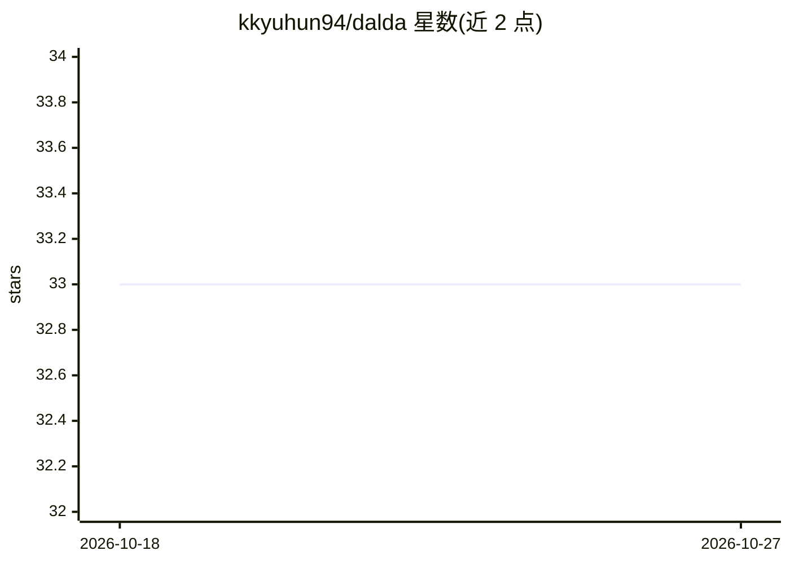

# kkyuhun94/dalda

⭐ 33 · Python · 推送 2026-02-06 · [GitHub](https://github.com/kkyuhun94/dalda) · 组织维护

**用 LLM 与扩散模型生成合成数据的训练增强框架**

ECCV 2024 Workshop Oral 论文 DALDA 的官方实现：在数据稀缺场景下，通过 LLM 向文本提示嵌入新语义信息，并以真实图像作为视觉提示，由扩散模型生成语义丰富且贴近目标分布的合成图像，用于下游分类器训练的数据增强。提供环境配置、数据集下载（Flowers102/Oxford Pets/Caltech101）、基于 Azure OpenAI（GPT-4）的提示生成脚本与训练脚本；需自建 .env 配置 Azure 端点，代码参考 DA-Fusion 并集成 IP-Adapter、diffusers 与 CLIP。

## 筛选速览

| 维度 | 判定 | 备注 |
|---|---|---|
| AI 角色 | `ai-native` | 本体是模型或模型工具 |
| 许可风险 | `none` | — |
| 部署形态 | `None` |  |
| 模型依赖 | — | README 未给出锁定关系 |
| 硬件要求 | — | 无带数字的原话,不猜 |
| 安装摩擦 | `low` | 无编译、无系统依赖或容器化 |
| 成熟度 | — | 结构信号不足 |

## 能力要点

- LLM 生成含新语义信息的文本提示，真实图像作视觉提示
- 扩散模型生成合成图像用于数据增强
- 支持按配置文件训练分类器及 resume 断点续跑
- 提供 Flowers102/Oxford Pets/Caltech101 数据集下载流程

## 适用场景

- 小样本图像分类任务的训练数据扩充
- 复现或扩展 ECCV'24 DALDA 论文实验
- 研究生成式数据增强对分类器性能的影响

## 场景标签

 · 领域:计算机视觉/合成数据

## 证据(README 行号)

> L10: DALDA is an effective data augmentation framework leveraging the Large Language Model (LLM) and Diffusion Model (DM
> L54: To generate prompts using LLM(we used GPT-4), you need to set up the environment and run the appropriate script. Fo

## 星数曲线

2026-10-18 33 → 2026-10-27 33（+0）

---
*卡片 v1 · prompt 1.4 · 生成 2026-10-25 · 置信度 high · 依据 README sha `213e0250cca0` · [字段定义](../../DATASET.md)*
