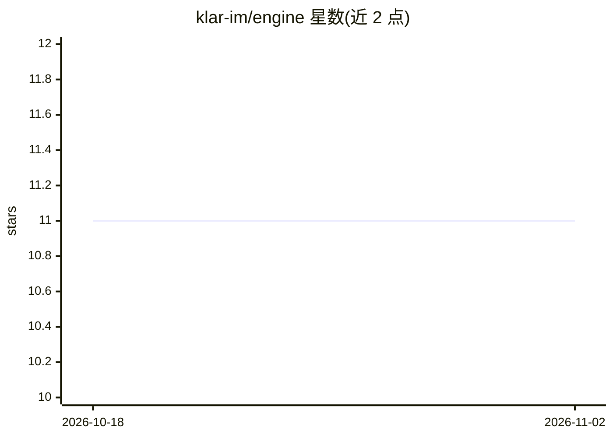

# klar-im/engine

⭐ 11 · C++ · AGPL-3.0 · 推送 2026-10-08 · [GitHub](https://github.com/klar-im/engine) · [官网](https://klar.im/) · 组织维护

**自建邮件服务器上的 transformer 垃圾邮件过滤引擎**

运行在自有邮件服务器上的 milter 垃圾过滤引擎：以 llama.cpp/GGML 推理 multilingual-e5-base 微调模型（Q8_0 304MB，仅 CPU），将邮件分为 spam/marketing/regular 三类，并把判定写入 X-Klar-* 头供 Sieve 规则分拣。支持 Stalwart、Postfix 及任何 libmilter MTA，消息不出本机，仅存元数据。提供一行安装脚本、预编译 x86_64/arm64 二进制、多架构容器镜像与 systemd 单元；另含稳定 C ABI、Node.js 绑定与端上增量训练接口。模型权重不随仓库分发，首次启动经许可确认后下载。

## 筛选速览

| 维度 | 判定 | 备注 |
|---|---|---|
| AI 角色 | `ai-native` | 本体是模型或模型工具 |
| 许可风险 | `dual` | AGPL-3.0 |
| 部署形态 | `self-host` | docker 或自建部署 |
| 模型依赖 | local-ok | 支持本地模型 |
| 硬件要求 | `cpu-ok` | |
| 安装摩擦 | `low` | 无编译、无系统依赖或容器化 |
| 成熟度 | — | 结构信号不足 |

## 能力要点

- 三分类（spam/marketing/regular）判定写入 X-Klar-* 邮件头
- llama.cpp 上运行 multilingual-e5-base 微调模型，仅 CPU，304MB 量化
- Stalwart 影子模式可与内置过滤器并行对比打分
- 稳定 C ABI、Node.js N-API 绑定与端上增量训练接口
- make import 可导入 Hugging Face 的 XLM-RoBERTa 垃圾邮件模型

## 适用场景

- 在自建 Postfix/Stalwart 邮件服务器上做本地垃圾邮件分类
- 让营销邮件进独立文件夹而非垃圾箱
- 通过 C ABI 或 Node.js 绑定把分类引擎嵌入客户端或服务
- 用 IMAP 文件夹中的用户标注做端上增量训练

## 场景标签

 · 领域:邮件安全/自托管基础设施

## 证据(README 行号)

> L23: - **A real language model, not regexes.** A multilingual transformer encoder
> L24:  (`intfloat/multilingual-e5-base`, fine-tuned by Klar) on llama.cpp, CPU only,
> L26: - **Three classes, not one score.** Spam, marketing and regular mail, so a

## 星数曲线

2026-10-18 11 → 2026-11-02 11（+0）

---
*卡片 v1 · prompt 1.4 · 生成 2026-11-02 · 置信度 high · 依据 README sha `30b34e36ee95` · [字段定义](../../DATASET.md)*
