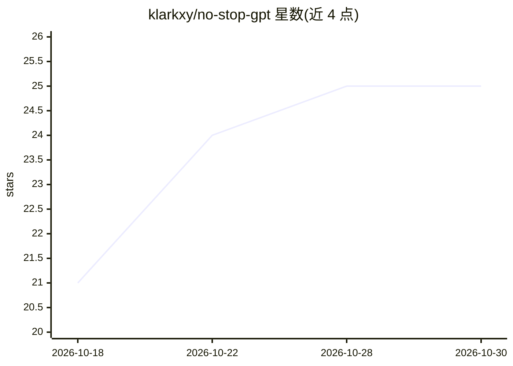

# klarkxy/no-stop-gpt

⭐ 25 · NOASSERTION · 推送 2026-10-02 · [GitHub](https://github.com/klarkxy/no-stop-gpt) · 个人维护 · 中文 README

**约束编码 Agent 避免过度工程的 agent 技能**

面向编码 Agent 的 SKILL.md 格式技能包：在实现功能、审查 diff、子系统清理与界面文案精简等场景中，阻止 Agent 添加不必要的抽象层、重复状态和掩盖失败的回退逻辑，要求以与需求相称的复杂度交付完整行为。提供 Prevent/Audit/Sweep/Less is more 四种工作模式，审计请求保持只读；附设计参考、反模式与 Sweep 工作流文档，无需额外运行时。通过 skills CLI 安装或手动复制目录。

## 筛选速览

| 维度 | 判定 | 备注 |
|---|---|---|
| AI 角色 | `ai-ecosystem` | LLM/agent 周边工具 |
| 许可风险 | `none` | NOASSERTION |
| 部署形态 | `library` | 以包/库形式分发 |
| 模型依赖 | — | README 未给出锁定关系 |
| 硬件要求 | — | 无带数字的原话,不猜 |
| 安装摩擦 | `low` | 无编译、无系统依赖或容器化 |
| 成熟度 | — | 结构信号不足 |

## 能力要点

- Prevent/Audit/Sweep/Less-is-more 四种工作模式
- 审计模式只读输出 keep/remove/downgrade/decide 结论及证据
- 覆盖前端文案精简（Less is more）指引
- 无额外运行时依赖，纯指令型技能

## 适用场景

- 让编码 Agent 实现功能时按比例控制复杂度
- 审查 diff 或清理子系统中的过度设计与冗余防御
- 精简生成界面中的冗余文案

## 场景标签

`编码 Agent` `代码审查` · 领域:编码与开发

## 证据(README 行号)

> L3: Agent Skill
> L28: Invoke `no-stop-gpt` explicitly, or let a host that supports automatic discovery
> L54: The skill follows OpenAI's Rethinking skills and prompts for GPT-6 Astra:

## 星数曲线

2026-10-18 21 → 2026-10-30 25（+4）

---
*卡片 v1 · prompt 1.4 · 生成 2026-10-27 · 置信度 high · 依据 README sha `9949d5feccd7` · [字段定义](../../DATASET.md)*
