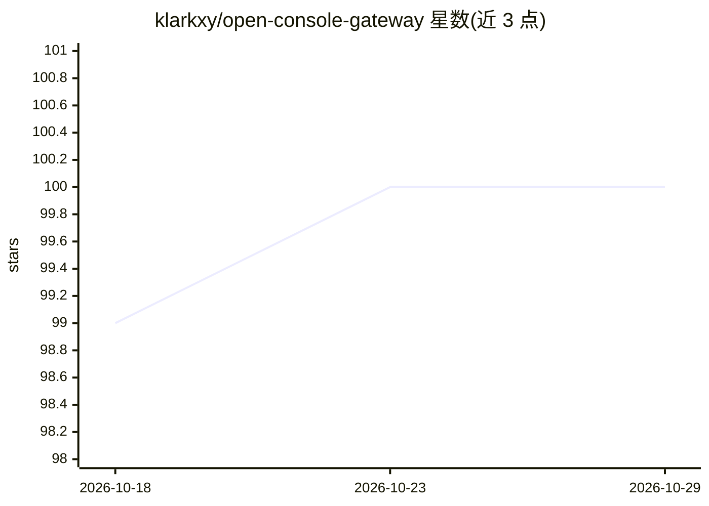

# klarkxy/open-console-gateway

⭐ 100 · Rust · NOASSERTION · 推送 2026-10-09 · [GitHub](https://github.com/klarkxy/open-console-gateway) · [官网](https://klarkxy.github.io/open-console-gateway/) · 个人维护 · 中文 README

**本地自托管 AI 订阅与 API 网关：统一接入多家服务商**

运行在用户自己机器上的网关服务：在一个面板中管理多家 AI 服务商的订阅账号与自有 API 连接，通过统一入口地址和自有 Key 为聊天应用与编程工具提供接口。支持拖拽设置账号优先级，账号触发速率限制时可自动切换其他兼容账号；面板展示用量、余额与请求日志。内置支持 OpenCode Go、Zen Free、Kimi Code CN、MiniMax CN Token Plan、Command Code GOAT，也可添加兼容 API 服务。提供 Windows/macOS 安装包、Linux 与 Docker 运行方式。

## 筛选速览

| 维度 | 判定 | 备注 |
|---|---|---|
| AI 角色 | `ai-ecosystem` | LLM/agent 周边工具 |
| 许可风险 | `none` | NOASSERTION |
| 部署形态 | `None` |  |
| 模型依赖 | — | README 未给出锁定关系 |
| 硬件要求 | — | 无带数字的原话,不猜 |
| 安装摩擦 | `low` | 无编译、无系统依赖或容器化 |
| 成熟度 | — | 结构信号不足 |

## 能力要点

- 一个面板集中管理多家服务商订阅账号与自有 API
- 拖拽设置账号优先级，速率受限时自动切换兼容账号
- 统一入口地址与 Key 供聊天应用和编程工具接入
- 展示用量、余额与请求日志

## 适用场景

- 把多个 AI 订阅账号整合成一个入口给桌面应用和编程工具用
- 账号触发限额时自动切换到其他账号继续使用
- 查看各账号的用量与余额以掌握消费情况

## 场景标签

`模型网关` · 领域:Agent 开发

## 证据(README 行号)

> L7: Manage your provider accounts in one place and connect them to the desktop apps
> L27: - **Give your tools one entry point.** Connect compatible chat apps and coding

## 星数曲线

2026-10-18 99 → 2026-10-29 100（+1）

---
*卡片 v1 · prompt 1.4 · 生成 2026-10-23 · 置信度 high · 依据 README sha `8496ef0cd7f3` · [字段定义](../../DATASET.md)*
