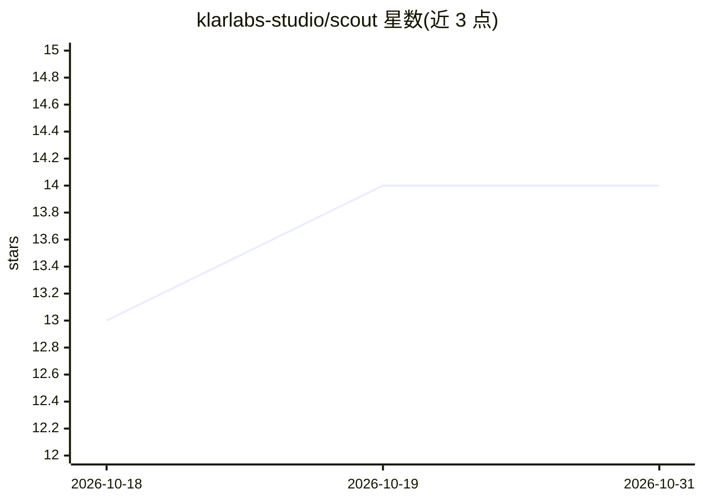

# klarlabs-studio/scout

⭐ 14 · Go · MIT · 推送 2026-10-29 · [GitHub](https://github.com/klarlabs-studio/scout) · [官网](https://klarlabs-studio.github.io/scout/) · 组织维护

**单二进制浏览器自动化工具：CLI/MCP 服务器/聊天 UI/Go 库四合一**

一个静态链接的 Go 二进制 scout，通过 CDP 驱动真实浏览器，同一引擎提供四种访问方式：一次性命令的 CLI、内置 MCP 服务器（供 Claude Desktop、Cursor 等 MCP 客户端调用浏览器工具）、流式 SSE 的对话式浏览器 UI（支持 Ollama/Anthropic/OpenAI 兼容端点），以及带中间件组合的 Go 库。工具覆盖导航、表单、提取、截屏、录屏、网络捕获、回放等类别，提取路径带 DOM diff 与 token 预算机制。Homebrew cask 安装，MIT 许可。

## 筛选速览

| 维度 | 判定 | 备注 |
|---|---|---|
| AI 角色 | `ai-ecosystem` | LLM/agent 周边工具 |
| 许可风险 | `permissive` | MIT |
| 部署形态 | `None` |  |
| 模型依赖 | local-ok | 支持本地模型 |
| 硬件要求 | — | 无带数字的原话,不猜 |
| 安装摩擦 | `medium` | 含编译或系统依赖之一 |
| 成熟度 | — | 结构信号不足 |

## 能力要点

- 单一 ~15MB 静态二进制，无 Node/Python 运行时依赖
- 内置 MCP 服务器，87 个带 ReadOnly/Idempotent 注解的浏览器工具
- 对话式浏览器 UI，支持 Ollama 本地模型与 OpenAI 兼容端点
- Gin 风格 Go 库：中间件含 Retry/Stealth/CircuitBreaker 等

## 适用场景

- 给 MCP 客户端（Claude Desktop、Cursor 等）接入浏览器操作能力
- 用 CLI 对网页做一次性结构化提取、markdown 转换与截图
- 在 Go 程序中嵌入带中间件链的浏览器自动化
- 录制浏览器操作为视频或可回放 playbook

## 场景标签

`浏览器自动化` `网页抓取` · 领域:效率与自动化

## 证据(README 行号)

> L14: A single statically-linked `scout` binary gives you a CLI, an 87-tool MCP server (so any MCP-aware agent — Claude D
> L27: |AI-agent native|**built-in** `scout mcp serve`|separate `playwright-mcp` project|

## 星数曲线

2026-10-18 13 → 2026-10-31 14（+1）

---
*卡片 v1 · prompt 1.4 · 生成 2026-10-31 · 置信度 high · 依据 README sha `5c7b2df912ed` · [字段定义](../../DATASET.md)*
