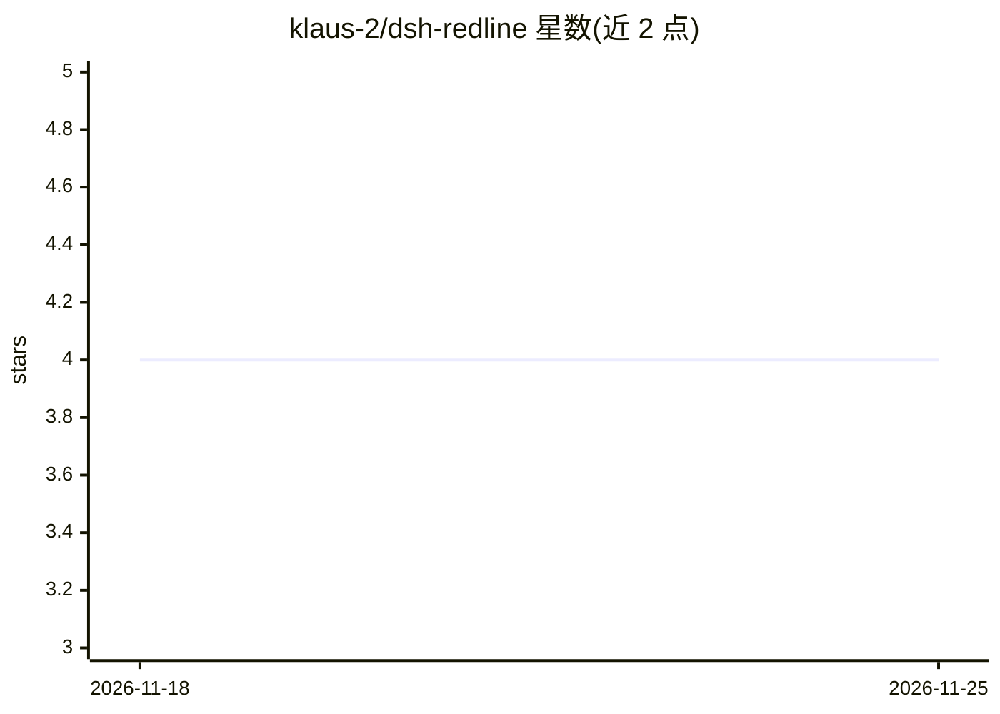

# klaus-2/dsh-redline

⭐ 4 · JavaScript · MIT · 推送 2026-11-21 · [GitHub](https://github.com/klaus-2/dsh-redline) · [官网](https://www.npmjs.com/package/dsh-redline) · 个人维护 · 中文 README

**给 DeepSeek Harness 用户的浏览器可视化反馈与设计评审插件**

dsh-redline 是 DeepSeek Harness 的插件，在 harness 浏览器渲染的页面上提供可视化反馈：选中元素、添加评论、实时调整样式（文本/颜色/排版/间距/边框/阴影），确认后以结构化上下文和裁剪截图随下一条消息发送给编码 agent。另提供自由画布标注、CSS patch 导出、可访问性审计、待办报告导出（Markdown/JSON）。通过 dsh plugin 命令安装，回环服务器绑定 127.0.0.1 并以实例 secret 鉴权。

## 筛选速览

| 维度 | 判定 | 备注 |
|---|---|---|
| AI 角色 | `ai-ecosystem` | LLM/agent 周边工具 |
| 许可风险 | `permissive` | MIT |
| 部署形态 | `None` |  |
| 模型依赖 | locked-api |  |
| 硬件要求 | — | 无带数字的原话,不猜 |
| 安装摩擦 | `low` | 无编译、无系统依赖或容器化 |
| 成熟度 | — | 结构信号不足 |

## 能力要点

- 元素级标注：selector、role、文本、评论与裁剪截图打包为结构化块发给 agent
- 实时样式检查器，提交后可导出 selector { prop: value; } 形式的 CSS patch
- 自由画布标注（画笔/箭头/矩形/编号标记等）合成进整页截图
- 回环服务器仅绑定 127.0.0.1，私有路由需实例 secret

## 适用场景

- 在浏览器中点选 UI 元素向编码 agent 提交修改意见
- 设计评审时实时试调样式并把改动作为上下文传给 agent
- 对页面做可访问性检查并生成快速修复

## 场景标签

`编码 Agent` · 领域:编码与开发

## 证据(README 行号)

> L9: `dsh-redline` is a visual feedback and design review plugin for DeepSeek Harness — think Figma comments / Vercel Too
> L79: dsh plugin --profile web add dsh-redline
> L136: The client face injects the overlay into every page the harness browser renders. The overlay sends the annotations

## 星数曲线

2026-11-18 4 → 2026-11-25 4（+0）

---
*卡片 v1 · prompt 1.4 · 生成 2026-11-21 · 置信度 high · 依据 README sha `63c6a442fb17` · [字段定义](../../DATASET.md)*
