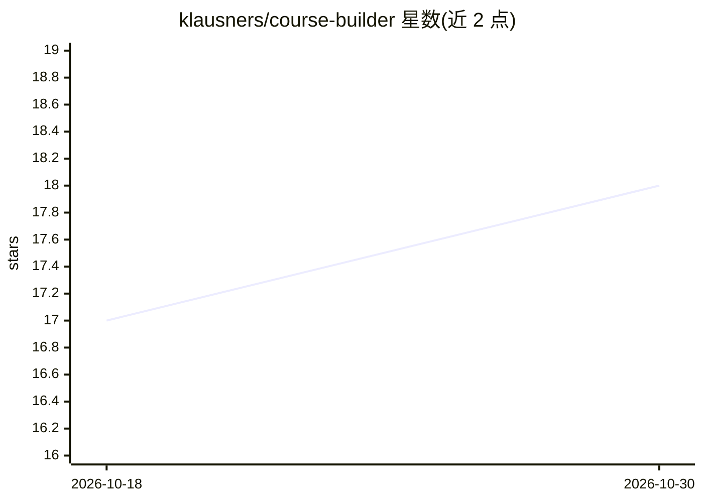

# klausners/course-builder

⭐ 18 · Shell · MIT · 推送 2026-10-27 · [GitHub](https://github.com/klausners/course-builder) · 个人维护

**Claude Code 插件：基于真实文章研究并生成结构化课程**

运行于 Claude Code 内的纯 Markdown 插件（无构建步骤），由一个技能和三个子代理组成：source-reader 并行阅读 10-25+ 篇真实文章与 YouTube 字幕并输出结构化摘录，course-builder 做检索、quorum 事实验证（3+ 独立来源为高置信）与课程合成，innovation-scout 补充创新机会章节。支持三种研究深度、增量模式、持久化记忆与 PDF 导出。限制：依赖网络访问、仅限 Claude Code 运行、生成耗时 5-30+ 分钟、token 消耗较大。

## 筛选速览

| 维度 | 判定 | 备注 |
|---|---|---|
| AI 角色 | `ai-ecosystem` | LLM/agent 周边工具 |
| 许可风险 | `permissive` | MIT |
| 部署形态 | `library` | 以包/库形式分发 |
| 模型依赖 | locked-api |  |
| 硬件要求 | — | 无带数字的原话,不猜 |
| 安装摩擦 | `low` | 无编译、无系统依赖或容器化 |
| 成熟度 | — | 结构信号不足 |

## 能力要点

- 多代理流水线：source-reader 并行读源 + quorum 事实验证 + innovation-scout 缺口分析
- 每课附来源链接与研究元数据（检索数、阅读数、quorum 统计、失败记录）
- 来源多样性强制（≥3 作者视角、≥1 反对观点、≥2 实践型来源）
- 利用 Claude Code 持久化记忆跨课程学习用户偏好

## 适用场景

- 让 Claude Code 基于真实资料为我生成可学习的结构化课程
- 在已有课程上增量添加新模块
- 产出带来源引用与置信度标注的参考级学习材料

## 场景标签

`多智能体` `教程课程` · 领域:Agent 开发

## 证据(README 行号)

> L3: > A Claude Code plugin that researches real articles and YouTube videos, cross-references facts, and synthesizes str
> L235: - **Claude Code only.** The plugin runs inside Claude Code (terminal, desktop app, IDE extensions). It is not a st
> L122: 1. The **course skill** runs in your main conversation. It asks the scoping questions (subagents can't talk to you

## 星数曲线

2026-10-18 17 → 2026-10-30 18（+1）

---
*卡片 v1 · prompt 1.4 · 生成 2026-10-29 · 置信度 mid · 依据 README sha `02aef362a74b` · [字段定义](../../DATASET.md)*
