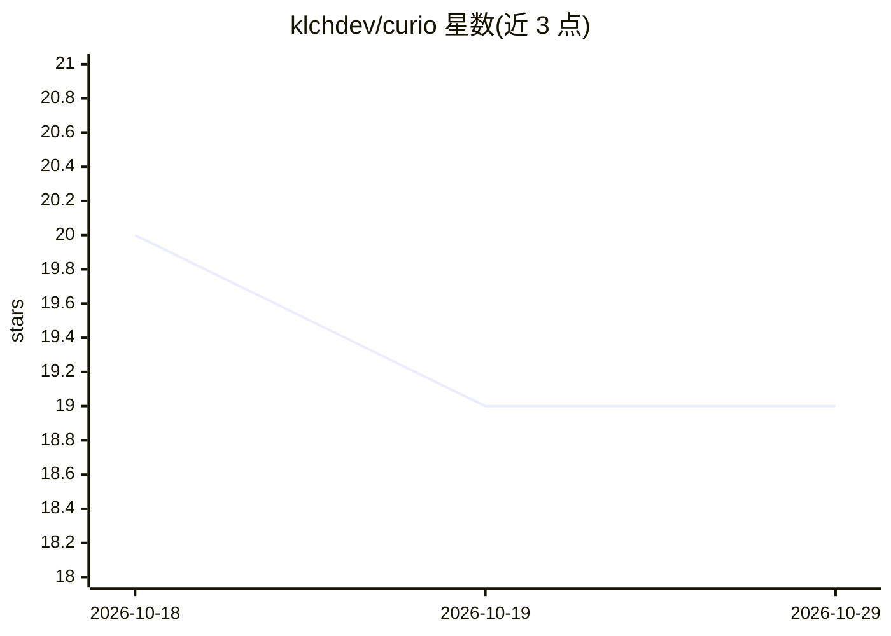

# klchdev/curio

⭐ 19 · TypeScript · MIT · 推送 2026-10-09 · [GitHub](https://github.com/klchdev/curio) · [官网](https://curio.klch.dev) · 个人维护

**自托管的游戏游玩日志应用：基于你的文字生成下一步玩什么的建议**

连接 Steam 库的自托管 Web 应用：玩家在游玩过程中随时写下多条评论，条目自动盖上真实 Steam 游戏时长戳；这些文字由 LLM 汇总为品味画像、未玩游戏分层清单与单游戏深度分析。BYOK 模式：用户自带模型 key（Gemini/Claude/OpenAI），key 以 AES-256-GCM 加密存储；也可走本机 Claude Code/Codex CLI 订阅计费。另含基于两个 Steam 信号的分钟级游玩记录追踪器。技术栈 Astro 6/React 19/PostgreSQL，提供 Render、Railway、Docker Compose 与本地 npm 四条部署路径。

## 筛选速览

| 维度 | 判定 | 备注 |
|---|---|---|
| AI 角色 | `ai-native` | 本体是模型或模型工具 |
| 许可风险 | `permissive` | MIT |
| 部署形态 | `self-host` | docker 或自建部署 |
| 模型依赖 | locked-api |  |
| 硬件要求 | — | 无带数字的原话,不猜 |
| 安装摩擦 | `low` | 无编译、无系统依赖或容器化 |
| 成熟度 | — | 结构信号不足 |

## 能力要点

- 多条评论按时间线累积，自动附带 Steam 真实时长戳
- LLM 生成品味画像与未玩游戏分层建议，条目回链到自己的原话
- BYOK：支持 Gemini/Claude/OpenAI key，或经本机 Claude Code/Codex CLI 订阅计费
- 分钟级游玩历史追踪（双信号轮询）与小时级热力图

## 适用场景

- 记录自己对每个游戏不同阶段的看法并看演变
- 根据自己写下的文字获得玩什么的分层建议
- 自托管并用自己的模型 key 控制数据与费用

## 场景标签

`知识库管理` `AI 写作` · 领域:内容生成

## 证据(README 行号)

> L179: The write-ups, the advice and the verdicts come from a language model, and
> L184: Three key-based providers are supported:
> L197: Two more providers need no key at all — **Claude Code (CLI)** and **Codex

## 星数曲线

2026-10-18 20 → 2026-10-29 19（-1）

---
*卡片 v1 · prompt 1.4 · 生成 2026-10-28 · 置信度 high · 依据 README sha `c55bfe5a143d` · [字段定义](../../DATASET.md)*
