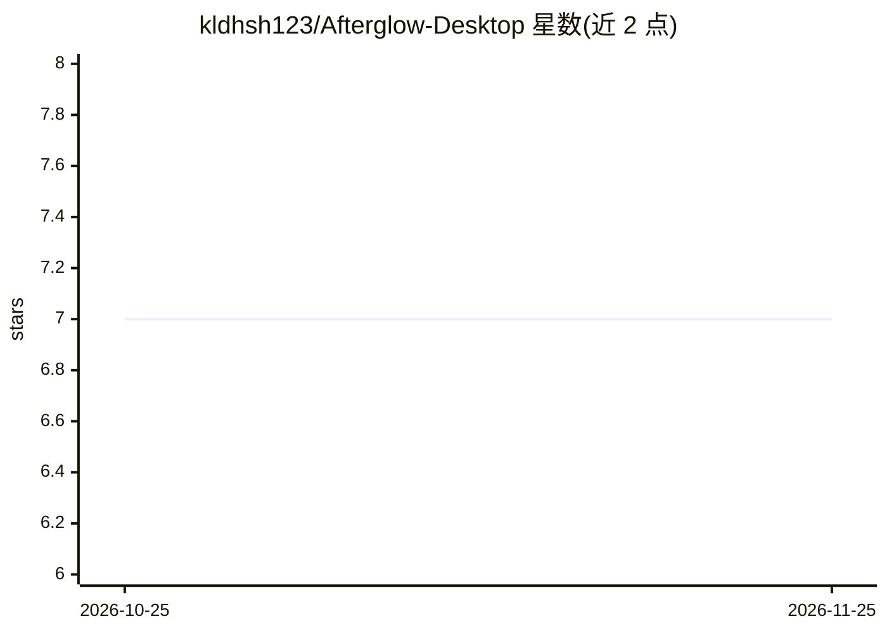

# kldhsh123/Afterglow-Desktop

⭐ 7 · Python · AGPL-3.0 · 推送 2026-10-24 · [GitHub](https://github.com/kldhsh123/Afterglow-Desktop) · [官网](https://afterglow.kldhsh.top) · 个人维护 · 中文 README

**基于真实聊天记录构建 RAG 记忆的本地 AI 陪伴桌面端**

Afterglow 的 Windows 桌面客户端，为本地托管的 AI 陪伴应用提供图形界面。它清洗、切分并向量化真实聊天记录，结合角色设定、作息模式与关系记忆，通过 RAG 为聊天模型提供相关历史证据，使新对话延续熟悉的交流方式。应用内置原版核心与便携 Python，提供引导配置、模型连接、聊天记录导入、聊天与分析功能，支持 QQ/微信扩展，各安装实例配置与数据相互隔离。仅支持 Windows x64，不支持 macOS。

## 筛选速览

| 维度 | 判定 | 备注 |
|---|---|---|
| AI 角色 | `ai-native` | 本体是模型或模型工具 |
| 许可风险 | `viral` | AGPL-3.0 |
| 部署形态 | `None` |  |
| 模型依赖 | — | README 未给出锁定关系 |
| 硬件要求 | — | 无带数字的原话,不猜 |
| 安装摩擦 | `low` | 无编译、无系统依赖或容器化 |
| 成熟度 | — | 结构信号不足 |

## 能力要点

- 从真实聊天记录构建可检索的关系记忆、角色设定与表达风格
- RAG 免微调路径：清洗、切分、向量化历史对话并检索相关证据
- 内置原版核心与便携 Python，无需单独安装 Python
- QQ/微信集成扩展与按安装实例隔离的配置数据

## 适用场景

- 导入 QQ/微信聊天记录，构建延续过往语气与记忆的 AI 陪伴
- 本地托管个人 AI 伴侣，配置自己的模型服务凭据
- 对导入的聊天历史进行分析和处理

## 场景标签

`RAG` `AI 助手` · 领域:对话与助手

## 证据(README 行号)

> L23: Afterglow is a locally hosted AI companion. It builds retrievable relationship memories, persona and expressive sty
> L29: **Afterglow Desktop is the Windows desktop app for Afterglow.** It bundles the original core and portable Python, b
> L25: It cleans, splits and vectorizes real chats, then combines persona, circadian patterns, Life state and relationship

## 星数曲线

2026-10-25 7 → 2026-11-25 7（+0）

---
*卡片 v1 · prompt 1.4 · 生成 2026-11-20 · 置信度 high · 依据 README sha `42442d8f670d` · [字段定义](../../DATASET.md)*
