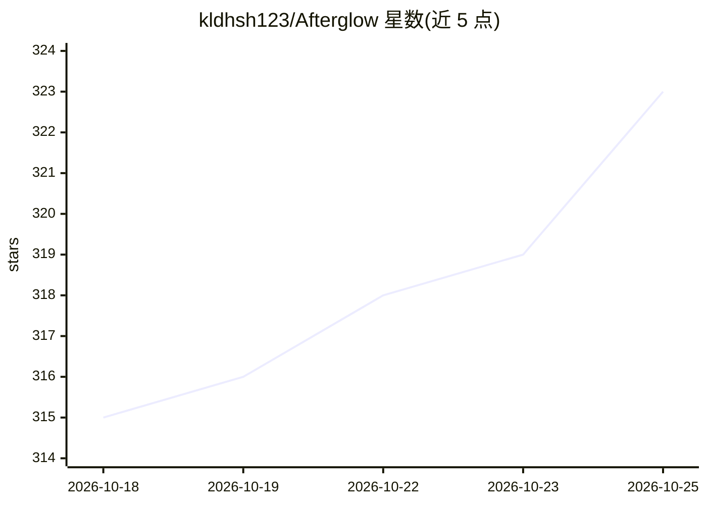

# kldhsh123/Afterglow

⭐ 323 · Python · AGPL-3.0 · 推送 2026-10-24 · [GitHub](https://github.com/kldhsh123/Afterglow) · [官网](https://afterglow.kldhsh.top) · 个人维护 · 中文 README

**本地部署的 AI 陪伴应用：用真实聊天记录重建对话人格**

面向终端用户的本地托管 AI 陪伴系统：从 QQ、微信、抖音、WhatsApp、Telegram、Discord 等来源导入真实聊天记录，清洗、切分并向量化存入 LanceDB；结合人格画像、作息模式、生活状态与关系记忆做分层混合检索（RRF），通过 OpenAI 兼容 API 将历史对话风格带入新对话。不做模型微调，不修改权重；提供 xuwen analyze 离线关系分析报告。强调生成内容非本人，需获得授权使用数据。支持 Docker 与源码运行（Python 3.12 + uv）。

## 筛选速览

| 维度 | 判定 | 备注 |
|---|---|---|
| AI 角色 | `ai-native` | 本体是模型或模型工具 |
| 许可风险 | `viral` | AGPL-3.0 |
| 部署形态 | `self-host` | docker 或自建部署 |
| 模型依赖 | — | README 未给出锁定关系 |
| 硬件要求 | — | 无带数字的原话,不猜 |
| 安装摩擦 | `low` | 无编译、无系统依赖或容器化 |
| 成熟度 | — | 结构信号不足 |

## 能力要点

- 七种聊天来源导入与多文件画像聚合
- 五路向量检索 + RRF 混合排序，可选重写/重排
- 人格、作息、生活状态、关系记忆分层上下文
- OpenAI 兼容 Chat Completions / Responses API，本地 LanceDB 存储与 PII 脱敏

## 适用场景

- 把过去与某人的聊天记录导入，构建带其说话风格的 AI 陪伴对话
- 通过 QQ/微信 bot 适配器接入社交平台使用
- 用 OpenAI 兼容客户端连接自托管陪伴服务

## 场景标签

`RAG` `聊天机器人` · 领域:对话与助手

## 证据(README 行号)

> L35: Afterglow is a locally hosted AI companion. It cleans, splits and vectorizes real chats, then combines persona, cir
> L49: |Open integration|OpenAI-compatible Chat Completions and Responses APIs for external clients|

## 星数曲线

2026-10-18 315 → 2026-10-25 323（+8）

---
*卡片 v1 · prompt 1.4 · 生成 2026-10-21 · 置信度 high · 依据 README sha `d3b57a676cf8` · [字段定义](../../DATASET.md)*
