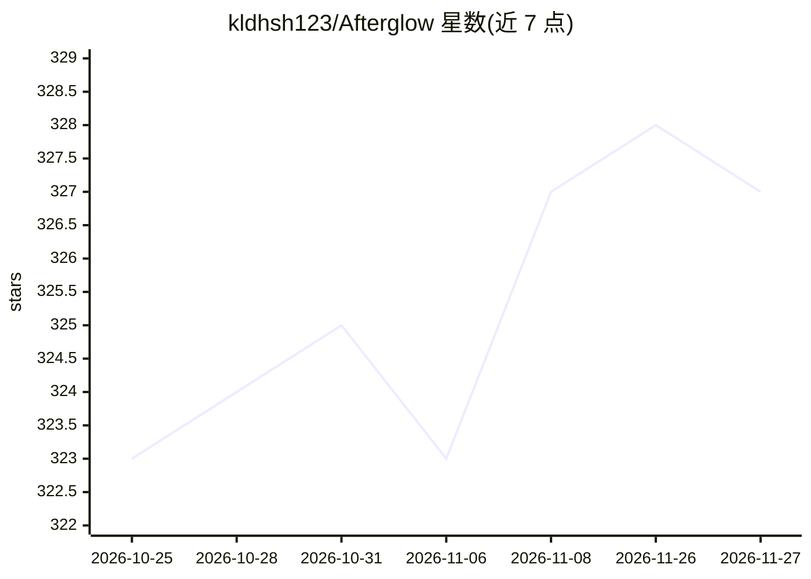

# kldhsh123/Afterglow

⭐ 327 · Python · AGPL-3.0 · 推送 2026-10-24 · [GitHub](https://github.com/kldhsh123/Afterglow) · [官网](https://afterglow.kldhsh.top) · 个人维护 · 中文 README

**用真实聊天记录经 RAG 构建本地 AI 陪伴应用**

Afterglow 是一个本地托管的 AI 陪伴应用：从 QQ、微信、抖音、WhatsApp、Telegram、Discord 等导出的聊天记录中清洗、切分并向量化，构建可检索的关系记忆、角色设定与表达风格，通过五路向量混合检索（RRF、可选重排）为聊天模型提供历史证据，生成延续原交流风格的回复。不微调模型权重；数据默认留在本地 LanceDB，支持 PII 脱敏与 Bearer 鉴权，提供 OpenAI 兼容 API 及 QQ/微信机器人适配器。README 提醒需获得数据授权并区分生成文本与真人。

## 筛选速览

| 维度 | 判定 | 备注 |
|---|---|---|
| AI 角色 | `ai-native` | 本体是模型或模型工具 |
| 许可风险 | `viral` | AGPL-3.0 |
| 部署形态 | `self-host` | docker 或自建部署 |
| 模型依赖 | — | README 未给出锁定关系 |
| 硬件要求 | — | 无带数字的原话,不猜 |
| 安装摩擦 | `low` | 无编译、无系统依赖或容器化 |
| 成熟度 | — | 结构信号不足 |

## 能力要点

- 多来源聊天导入：QQ、微信、抖音、WhatsApp、Telegram、Discord 等 7 种导出格式
- 五路向量混合检索，覆盖三类文本历史、图片描述与 Live memory，RRF 合并
- 分层人设与状态：persona、作息画像、Life state、关系记忆与回复策略
- OpenAI 兼容 Chat Completions/Responses API，可接外部客户端

## 适用场景

- 把和亲友的聊天记录变成可对话的记忆库
- 自建带人设与作息状态的 AI 陪伴服务
- 通过 QQ/微信机器人接入日常聊天

## 场景标签

`RAG` `聊天机器人` · 领域:对话与助手

## 证据(README 行号)

> L9: 通过真实聊天记录构建可检索的关系记忆、角色设定与表达风格。结合 RAG、角色上下文和兼容 OpenAI 的 API，让 AI 在新的对话中延续熟悉的交流方式。
> L38: Afterglow is a locally hosted AI companion. It cleans, splits and vectorizes real chats, then combines persona, cir
> L52: |Open integration|OpenAI-compatible Chat Completions and Responses APIs for external clients|

## 星数曲线

2026-10-25 323 → 2026-11-27 327（+4）

---
*卡片 v1 · prompt 1.4 · 生成 2026-11-25 · 置信度 high · 依据 README sha `37b8638f1b85` · [字段定义](../../DATASET.md)*
